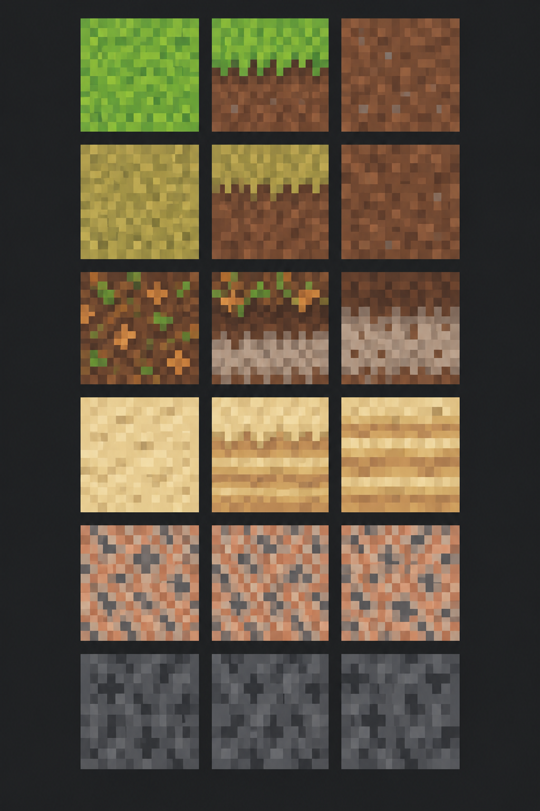

# Farmware 地形タイル表現仕様 — 材質上面・境界・断面構成

- 作成日: 2026-10-24
- 最終更新日: 2026-10-26
- 状態: 地形タイル表現の試作・確定用設計仕様
- 対象: GroundBlock、WallBlock、Liquidと、それらを表示するTilemap・Atlas・オートタイル
- 正となる論理データ: [バイオーム・生態コンテンツ仕様](../GameSpecification/BiomeEcologyContentSpecification.md)、[ランダムマップ生成仕様](../GameSpecification/RandomMapGenerationSpecification.md)
- 実装順: [実装ロードマップ](../Development/ImplementationRoadmap.md)
- 材質タイル制作ツール: AsepriteまたはPixelorama

## 1. 目的と適用範囲

本書は、41種類の地形材質を、少数色と単純なブロック状の模様で読み分けられるタイルとして制作するための基準を定める。全体の質感はMinecraftの材質ブロックのような簡潔さを参考にするが、既存作品の配色、模様、画素配置、固有意匠は複製しない。

本書の対象は地形のBase表現である。資源、鉱床、植物、生物、建築物、舗装、耕地、積雪、苔、落葉、灰、塩殻などは、地形とは別の状態またはOverlayとして扱う。まず代表材質を試作して仕様を確定し、全41材質の量産とRuntime切替は後続工程で行う。

## 2. 2026-10-24以降に変更した基本方針

次を新しい基本方針とする。

- 材質タイルはAsepriteまたはPixeloramaで1 px単位に手描きする。PixelLabは材質タイルの生成、Prompt作成、配色決定には使用しない。
- 各材質は`GroundTop`、任意の`FaceBoundaryOverlay`、`Face`の3種類を制作単位とする。Wall上面専用Spriteは制作せず、同じ材質の`GroundTop`を再利用する。
- 断面は境界の有無にかかわらず、1段目から通常の`Face`を使う。
- `FaceBoundaryOverlay`を持つ材質では、透明背景のOverlayを断面1段目の`Face`へ重ねる。持たない材質には空の透明Spriteや共通の代替境界を作らない。
- Wall上面には同じ材質の`GroundTop`差分を使い、RGBへ`WallDarkenFactor`を乗算してGroundより暗く表示する。通常材質の初期値は0.85とする。全材質共通の黒い内部、材質別のWall外周部品、専用`WallTop`完成Spriteは作らない。
- Wallは0.85暗色化、手前に露出する`Face`、固定接地影、設置面起点の動的影を共通条件とする。追加する補助表現は、Wall前面上端から8px／16px／32pxで減衰する折れ目影3案とWall上面の1px境界ハイライトを専用Sceneで比較し、32px折れ目影を採用した。初回確認で32pxが全体暗化に見えた原因には比較用動的影の不安定な挙動が混在していたため、折れ目影自体の評価を見直した。8px、16px、1px境界ハイライトは不採用とし、複数案を併用しない。不採用案の素材、Material／Shader、Atlas、選択処理、Scene参照、専用テストはC6-Dの製品表示置換で削除する。
- Ground崖面とWall前面は、同じ材質の`FaceBoundaryOverlay`入力と`Face`を共有する。境界あり材質ではEditorがGround用の元色合成結果と、Wall用にOverlayだけを暗色化した合成結果を生成する。
- 地形輪郭は初期実装では論理セルに沿う直線とする。不規則な凹凸は後からPresentation表現として追加できるよう、衝突、採掘、配置、保存から分離する。

Wallの視認性は、`GroundTop`全体の0.85暗色化、Wall前面2段をまたぐ共通折れ目影、手前に露出する`Face`、2段Wall向けに左右各1px・手前3pxへ広げた固定接地影、URP 2D Rendererの`Light 2D`と`Shadow Caster 2D`による動的影を組み合わせて確保する。折れ目影は黒を上端Alpha 35%から32画素目の0%まで1px単位で線形減衰させる。本番Presentationでは共通設定から勾配幅を調整できる構成にするが、初期採用値は32pxとする。材質ごとに幅を変えると隣接Wallで折れ目が跳ねるため、同じWall表示内では全材質が同じ幅を使う。材質別Spriteを作らず、共通OverlayとしてWall前面2段へ開始行0px／16pxで重ね、`Face`本体は暗色化しない。固定接地影は各レイヤーAlpha 22%の2枚を重ねる。材質が異なるWall同士も連続したWall領域として接続し、共有辺には`Face`、折れ目影、固定接地影、動的影の切れ目を出さない。材質の違いは`GroundTop`の色と模様で表現する。

## 3. 材質ごとの上面・境界・断面構成

### 3.1 固定寸法

| 部位 | 寸法 | 用途 | 必須 |
| --- | ---: | --- | --- |
| `GroundTop` | 16×16 px | Ground上面に使う材質表面 | 必須 |
| `FaceBoundaryOverlay` | 16×16 px | 透明背景へ表層、風化層、草の垂れ、層境界など、断面1段目に追加する画素だけを描く | 材質ごとに任意 |
| `Face` | 16×16 px | 境界の有無にかかわらず断面1段目以降へ使う通常断面 | 必須 |

`FaceBoundaryOverlay`は16×16 pxの透明な制作素材とする。Editor生成ツールが、選択された`Face`差分と元色のOverlayを合成してGround用の断面1段目Spriteを生成する。Wall暗色化が有効な材質では、同じOverlayの不透明画素だけを`WallDarkenFactor`で暗色化し、元の`Face`と合成してWall用の断面1段目Spriteも生成する。`Face`自体を暗色化すると2段目へ移る位置で明るさが戻るため、Wall用でも`Face`は元色のままとする。Runtimeでは`Face`とOverlayを2枚重ねず、用途に対応する生成済み完成Spriteを1枚描画する。Overlayの不透明画素で`Face`を覆えるため、草から土、風化した表面から母岩、凍結表層から凍土のような局所的な切り替えも表現できる。

Wall上面は専用の入力・生成Spriteを持たない。材質定義の`GroundTop`配列から決定論的に選んだSpriteをWall表示レイヤーでも参照し、表示色へ`WallDarkenFactor`を乗算する。

`FaceBoundaryOverlay`は地形材質だけを対象とする。将来の橋など、断面1段全体の置換や複数段の前面を必要とする建築物は、地形材質へ混在させず、建築物側の専用上面・前面Spriteで表現する。

```text
Ground・境界あり: GroundTop → (Face + 元色OverlayのGround用合成結果)      → Face → Face → …
Ground・境界なし: GroundTop → Face                                         → Face → Face → …
Wall・境界あり:   GroundTop×0.85 → (Face + 暗色化OverlayのWall用合成結果 + 32px折れ目影前半) → (Face + 32px折れ目影後半) → Face → …
Wall・境界なし:   GroundTop×0.85 → (Face + 32px折れ目影前半)                                → (Face + 32px折れ目影後半) → Face → …
```

初期実装の表示段数はGround崖面を3段（48 px）、Wall前面を2段（32 px）とする。段数はPresentation専用の表示高であり、論理的な水深、Liquid量、WorldLayer、通行、採掘、セーブ値を変更しない。実画面で調整が必要になった場合も、GroundとWallの段数は個別に変更できる構成を維持する。

### 3.2 GroundとWallの組み立て

- GroundとWallは同じ材質の`GroundTop`配列を参照する。Wall表示だけ`WallDarkenFactor`を乗算し、通常材質の初期値を0.85とする。
- 同じ材質のGround崖面とWall前面は、同一の`FaceBoundaryOverlay`入力と`Face`を参照する。境界ありではGround用の元色合成結果とWall用の暗色化合成結果を分け、暗色化が無効ならWallもGround用合成結果を再利用する。
- 折れ目影は、Wall前面上端へ材質共通の黒いOverlayを重ねる。採用値は32pxで、上端Alpha 35%から2段目下端の0%まで1px単位で線形減衰させる。1段目と2段目には開始行0px／16pxのMaterialを使い、段境界でAlphaを上端値へ戻さない。専用比較では8px／16px／32pxと1px境界ハイライトを同条件で確認した。初回に32pxが全体暗化に見えた現象には比較用動的影の不安定な挙動が混在していたため、折れ目影単体を再評価して32pxを採用した。8px、16px、1px境界ハイライトは使用しない。本番では共通のPresentation設定から勾配幅を調整可能にする余地を残すが、初期値は全材質共通32pxとする。これは材質Spriteではなく、Wall上面と前面の向きが変わる位置を示すPresentation Overlayである。
- Wall前面の下へ同じ材質の水中Ground崖面が続く場合も、同じ`Face`を使って縦方向へ連続させる。
- Wallと下地Groundの材質が異なる場合は、論理的な材質境界で使用する断面素材を切り替える。
- Wall同士の物理接続判定は、Wall前面、固定接地影、`Shadow Caster 2D`輪郭に使う。材質IDを比較せず、隣接セルがWallなら接続扱いとする。
- 孤立Wallは結合シルエット全体から固定接地影と動的影を表示する。材質が異なるWall同士の共有辺には`Face`、固定接地影、動的影の切れ目を出さず、連続したWall領域として扱う。

### 3.3 材質ごとの可変配列とSprite数

各部位の差分数は事前に固定しない。材質定義のInspectorで必要な数だけ要素を追加できる可変長配列とし、登録した全要素を均等確率で選ぶ。個別のWeightや出現率Overrideは持たせない。不要な差分は配列へ残さず外し、特定の見た目を増やす必要が生じた場合も、同じSpriteを重複登録せず差分構成そのものを見直す。

材質ごとの数量を次の記号で表す。

| 記号 | 内容 | 許容数 |
| --- | --- | ---: |
| `G` | `GroundTop`差分数 | 1以上 |
| `F` | `Face`差分数 | 1以上 |
| `B` | `FaceBoundaryOverlay`差分数 | 0以上。0なら境界なし |
| `D` | Wall暗色化によるWall用境界Spriteの追加有無 | 有効なら1、無効なら0 |

| 区分 | 材質あたりのSprite数 |
| --- | ---: |
| 手描きする入力Sprite | `G + F + B` |
| Editorが生成する完成Sprite | `B > 0ならF×B×(1 + D)、B = 0なら0` |
| Runtimeで参照する材質Sprite候補 | `G + F + （B > 0ならF×B×(1 + D)、B = 0なら0）` |

最小構成の`G = 1`、`F = 1`、`B = 0`では、手描き入力は2 Sprite、Editor生成は0 Sprite、Runtime参照候補は2 Spriteとなる。境界ありの最小構成`G = F = B = 1`かつWall暗色化有効`D = 1`では、手描き入力は3 Sprite、Editor生成はGround用とWall用の2 Sprite、Runtime参照候補は5 Spriteとなる。固定接地影と動的影は材質Spriteを追加せず、表示側がWall領域の結合シルエットから生成する。

## 4. 手描き制作の基準

### 4.1 制作ツール

- 制作にはAsepriteまたはPixeloramaを使用し、どちらを選んでも完成仕様は同じにする。
- `GroundTop`、任意の透明な`FaceBoundaryOverlay`、`Face`を実寸16×16 px基準で最初から手描きする。生成画像の切り出しや補正を制作開始点にしない。Wall上面専用Spriteや暗色化後のWall用上面は手描きしない。
- PixelLab用のPrompt、Reference image、Style image、生成設定を材質タイルの制作記録へ含めない。
- 補間、ぼかし、アンチエイリアス、半端なAlphaを使わず、1 px単位で編集する。
- 制作記録には、使用ツール、パレット、差分数、境界の有無、修正履歴を残す。

### 4.2 共通画風

- 16×16 pxを遠目で見ても材質群を識別できる、低詳細でブロック状の模様にする。
- 1材質・1部位は原則3〜5色とする。必要な特徴が読める場合は3色未満でもよい。
- 写真調の細かなノイズ、全画素が激しく明滅する高コントラスト、輪郭線で囲んだ1セル単位のタイル感を避ける。
- 1 pxの点、2〜4 px程度の小塊、短い層、割れ、斑晶を材質に応じて使い分ける。同じ模様規則を全材質へ一律適用しない。
- Base Spriteには左右へ偏らない弱い上方光を基準とする固定明暗を含める。硬い投影影、松明など特定光源の色、時間帯の暗さは焼き込まず、動的な影はURP 2D Rendererの`Light 2D`と`Shadow Caster 2D`へ分離する。
- Normal Mapは初回41材質の必須成果物にしない。Base Sprite完成後、TIME-01Bで代表材質だけを比較する。

### 4.3 差分と接続

`GroundTop`、`Face`、`FaceBoundaryOverlay`は、すべて第3.3節の可変長配列で管理する。固定差分数は設けず、各配列内の候補は均等確率で選ぶ。`Face`と`FaceBoundaryOverlay`は独立に選択し、境界あり材質ではGround用の全組合せ`F×B`をEditorで事前生成する。Wall暗色化が有効なら、同じ組合せから暗色化Overlayを使うWall用`F×B`も生成する。

- `GroundTop`は外周を共通化せず、隣接した際に単一色の枠、密度の段差、規則的な帯が見えないようにする。
- 材質ごとにInspectorへ`DarkenWallSurface`と`WallDarkenFactor`を表示する。`DarkenWallSurface`は既定で有効とし、通常の材質ブロックは機械的に暗色化する。無効時は係数1.0として元色を使う。`WallDarkenFactor`は0より大きく1以下とし、初期比較値を0.85とする。最終値は代表5材質のGameビュー確認で調整する。
- Wall上面の暗色化は、Wall表示レイヤーが参照する`GroundTop` Sprite全体へ同じ`WallDarkenFactor`を乗算する。Alpha、Ground表示、Ground用`FaceBoundaryOverlay`、`Face`は変更しない。Wall用`FaceBoundaryOverlay`の不透明画素には同じ有効状態と係数を使う。
- Wall折れ目影は暗色化済み`WallTop`の下、Wall前面2段へ描画する。`FaceBoundaryOverlay`合成済みSpriteまたは通常`Face`の上へ共通Shaderで重ね、1段目を開始行0px、2段目を開始行16pxとして32pxの連続勾配にする。3段目以降、Ground崖面、水中へ続くGround断面には重ねない。折れ目影の勾配を材質パレットへ焼き込まない。
- Ground用の形状境界ハイライトは製品表示へ使わない。Wall用についても、14基本Spriteと90度回転による47状態の1px境界ハイライト案は専用比較で不向きと判断した。GroundとLiquidの境界は各Base SpriteとLiquid表現で読み分け、Wallは0.85暗色化、`Face`、固定接地影、動的影へ、正式採用した32px折れ目影だけを追加する。比較した8px／16px折れ目影と1px境界ハイライトは併用しない。
- Wall領域の投影影は`Shadow Caster 2D`で表現する。Caster形状は表示中のWall上面ではなく、Wall前面の表示段数だけ手前へ移した設置面を起点にする。現在の有効地形からサブチャンク単位で結合し、タイルごとのGameObjectやCasterを作らない。材質境界では分割せず、設置面へ投影したWall領域の外周だけを影輪郭にする。
- `FaceBoundaryOverlay`は左右方向に並べた際、表層の厚さや境界線の高さが不自然に途切れないようにする。透明部分では下の`Face`をそのまま見せ、不透明画素だけで必要な範囲を覆う。
- `Face`は、配列内の任意差分同士を上下左右へ隣接させても破綻しないようにする。境界を横断する地層や割れを描く場合は、全差分で接続座標と幅を共通化するか、外周をまたがせない。接続グループは初期仕様へ追加せず、相互接続では表現できない材質が実際に生じた場合だけ後続で検討する。
- どの差分同士でも完全に大模様を接続するのではなく、接続を必要とする模様を限定する。小石や斑晶などの独立模様は外周をまたがせない。
- 差分の均等選択は`UnityEngine.Random`を使わず、WorldLayer、絶対X/Y、断面段、安定材質ID、用途別の表示専用Saltから決定論的に求める。材質定義と生成バージョンが同じなら、同じワールド位置はロード、再描画、実行順にかかわらず毎回同じ差分になる。
- `GroundTop`、`Face`、`FaceBoundaryOverlay`には別々のSaltを使う。同じWallセルでは再描画や照明変化によって`GroundTop`差分を選び直さない。
- 配列要素、順序またはRuntime側の表示選択バージョンを変更すれば表示結果が変わり得る。これらはPresentation設定の意図的な変更として扱い、Simulation状態や保存データは変更しない。
- Inspectorと生成ツールは、必須配列が空、寸法が16×16 pxでない、いずれかの手描き入力に半透明画素がある、または`WallDarkenFactor`が0以下・1超の場合に生成を拒否して日本語で理由を表示する。生成数が大きい場合は、Ground用`F×B`と暗色化有効時のWall用`F×B`の内訳を示して警告する。配列内容や順序、暗色化の有効状態・係数、Overlayのいずれかを変更した場合は、影響する断面完成Spriteが古いことを表示して再生成する。

## 5. Liquidと深部

- 淡水と海水の水面は、同じ論理セルの`GroundTop`基準面より画面下へ3 px投影する。水Tile全体を下へ移動して隣接段へ重ねず、穴全体を覆う描画面の上端3 pxだけをShaderでクリップする。これはPresentation上の高さだけを変え、液体のWorldLayer、セル座標、通行、量、伝播を変更しない。マグマは本項の水面3 px低下を流用せず、不透明な専用表示規則を維持する。
- 淡水・海水がGroundまたはWallへ接する箇所には、画面手前辺を除く奥・左・右の露出辺へ、液体種ごとに共通の水際波線アニメーションを重ねる。飛沫や高さのある白波にはせず、太さ1 pxの連続線を2色の2px帯へ分け、整数Pixel単位で流す。材質別Spriteは作らず、現在の有効地形からU字状の接触辺を選ぶ。固定検品SceneではShaderで奥辺1本・左右辺各1本を描き、手前辺には描かない。波線を停止しても岸形状と液体種別をBase表示だけで判別できるようにし、仮配色の品質は完成素材の合否判定に含めない。
- 淡水・海水の水面反射には、垂直面だけを映す反射Proxy方式を採用する。斜め見下ろしで水平な`GroundTop`、`WallTop`、床は水面へ映さず、水面より上に立つWallの`Face`と将来の直立オブジェクトだけに反射Proxyを作る。Proxyは元Spriteを水際で上下反転・縦圧縮し、`WaterSurface` Sorting Layerへ`Liquid深度Overlay`の後、1 px波線の前に重ねる。画面全体を取り込まないため、地面、影、UIも反射対象外とする。検証値は最大深度32 px、縦圧縮0.75、最大Alpha 0.22、左右0／+1／0／-1 pxの整数変位を毎秒4 pxとし、本実装では同方式を維持したまま完成素材、液体色、時間帯、性能に合わせて詳細値を調整する。
- 淡水と海水は断面を不透明な床Tileで置換せず、通常の`Face`または`FaceBoundaryOverlay`合成済みの1段目用Spriteの上へ、半透明の`Liquid深度Overlay`を重ねる。
- Ground崖面の素材配置は1～3段目とする。液体のない乾燥崖では全段に黒い下地を置き、穴上端で100%見える`Face`を1枚の黒Overlayによって連続的に暗くし、48 px（3タイル目の下端）で可視Alpha 0%へ到達させる。4段目以降は完全な暗黒だけを表示する。淡水・海水では黒暗化を一切使わず、通常の`Face`または直下Underwater床の上へ青系`Liquid深度Overlay`を重ね、1枚の描画面内で1 px単位の連続Alpha勾配を作る。
- Surface表示では、同じX/Yの直下にあるUnderwaterの地面を4段目から簡易投影し、その地面上の表示対象オブジェクトも水越しに見せる。青Overlayはクリップ後の実表示深度45 px、すなわち穴上端から48 pxでAlpha 50%へ到達し、それより深い範囲では50%を維持する。黒OverlayやRGB暗化は加えない。これは直下1層だけのPresentationプレビューであり、図鑑発見、選択、遠隔操作、衝突、Simulation処理を発生させない。上層のGroundまたは不透明Wallに遮られるセルは表示しない。
- Underwaterの地面がない場合、SurfaceからDeepSeaの地面・配置物・生物は描画しない。代わりに現在材質の`Face`を6段目まで下地として続け、青Overlayをクリップ後の実表示深度93 px、すなわち穴上端から96 pxでAlpha 100%へ到達させる。以降は不透明な青を維持するため、Surfaceから2層下を透視しない。乾燥崖用の黒を水の背後へ入れず、途中で黒から青へ変わる不自然な色遷移を避ける。プレイヤーがUnderwaterにいる場合だけ、同じ方式で直下のDeepSeaを簡易表示できる。
- マグマは不透明とし、接触する最初の段から背後の`Face`と`FaceBoundaryOverlay`合成結果を見せない。半透明の深度表現をマグマへ流用しない。
- 淡水・海水用およびマグマ用の専用断面Spriteは作らない。マグマの波や発光を表す透明な表面エフェクトを使う場合も、不透明なマグマBaseの上へ重ねる。
- 固定検品Sceneの上部では、代表5材質のそれぞれを最小横8×奥行7セルの同一材質Groundパネルにする。Wallの左右・奥・手前へ同じ材質のGroundを各2セル以上露出させ、その中央へ同じ`GroundTop`を0.85を基本とする係数で暗色化したWall上面を重ね、手前へ`Face`を2段縦接続する。2段を通して32pxの共通折れ目影を連続表示し、2段目の根元に固定接地影を重ねる。さらにWall上面から2段手前の設置面へ`Shadow Caster 2D`を置き、弱いGlobal Light 2D、真上の主光、左手前の検証光を比較Scene Cと同じ条件で配置して、同材質Ground上の固定接地影と動的影を同時に確認する。穴検品では`GrassLoam`を使い、1セル幅のGroundTopで囲んだ横3×手前方向10セルの穴を、左から乾燥、淡水＋Underwater床、海水＋Underwater床、Underwater床なし、マグマの5条件で横1列へ並べる。乾燥穴は1～3段目の`Face`を黒い下地の上へ置き、穴全体を覆う黒Overlayで48 pxかけて可視Alpha 100%から0%へ連続変化させ、以降は完全な暗黒にする。淡水・海水はタイル単位のAlphaを廃止し、穴全体を覆う1枚のShader描画面で上端3 pxをクリップする。Underwater床ありは45 pxで青Overlay Alpha 50%、床なしは現在材質の`Face`を背後へ続けて93 pxでAlpha 100%へ到達する連続勾配とする。DeepSeaの内容自体は下地に使わない。水際は手前を除く奥・左・右へ、2色が整数Pixel単位で流れる1px波線をU字状に描く。マグマは全段Alpha 100%とする。これらは投影位置、重なり順、遮蔽、波線Animationを確認する検品値であり、製品版の最終的な液体色と波線配色ではない。
- 白い14形状の地形境界ハイライトはGroundへ使用せず、Wall用としても専用比較で不向きと判断した。32px折れ目影の正式採用により、境界ハイライトと不採用となった8px／16px折れ目影をC6-Dで削除する。F4のタイル・サブチャンク・チャンク診断表示は地形アートとは別機能として維持する。

## 6. 部位別パレットの読み方

第7章の境界色の有無、`GroundTop`、`FaceBoundaryOverlay`、`Face`の色・使用比率・模様方針は、`GrassLoam`で確認した低コントラスト基準を41材質へ適用した基準値である。Wall上面は同じ材質の`GroundTop` Spriteを参照し、Wall用の表示色は機械的な暗色化で作る。専用`WallTop`パレットと専用Spriteは設けない。代表SpriteのGameビュー確認で問題が見つかった場合は、個別Spriteだけを調整せず、第7章の仕様値またはWall暗色化設定を先に更新して同じ材質・部位の全差分へ反映する。

- `日本語名（案）`は制作・レビュー時に材質を読みやすくする表示名候補であり、既存仕様で固定済みの英語`TerrainMaterial ID`を変更しない。正式なゲーム内表示名として採用する場合は、ローカライズ仕様で別途確定する。
- `イメージ画像`は参考にするネット画像をMarkdown画像リンク（``）で貼り、表内にプレビューするための欄である。画像は選定できた材質から追加し、未選定の材質は空欄のままでよい。
- 表の`GroundTop色`、`境界色`、`Face色`は、それぞれGround上面、透明な`FaceBoundaryOverlay`、Ground崖面とWall前面で共用する断面の基準色である。41材質すべてについて、`GrassLoam`の部位別コントラストを基準に再調整した現在値を記載する。
- 独立した`断面境界`列は設けない。`境界色`が`なし`なら`FaceBoundaryOverlay`を作らず、色が記載されていれば作る。境界の有無はこの欄だけを正とする。
- 本書に記載する地形パレットは、全体として低コントラストを基準にする。`GrassLoam`のOKLab L最暗色・最明色間を基準に、`GroundTop`は約0.091、`FaceBoundaryOverlay`は約0.101、`Face`は約0.076を部位内明度幅の目安とする。8 bit HEXへの丸めによる±0.003程度の差は許容する。原則として最暗色と最明色を同じ面積で競合させないが、十分に明暗差を抑えたパレットへ個別の均等比率を指定した場合は、その個別値を優先する。材質の識別は大きな明暗差だけに頼らず、色相、模様、粒の大きさ、方向性で補う。
- `FaceBoundaryOverlay`と`Face`は、同じ材質の`GroundTop`より全体として暗くする。比較は使用比率を反映したOKLab Lの加重平均で行い、各パレット内部の明暗差は前項の目安以内に保つ。上面、境界、断面で同じ色相を使う必要はなく、草から土、風化層から母岩のような材質構造を優先する。41材質への調整では、各部位の加重平均明度、色相、彩度をできるだけ維持し、過剰な明暗差だけを圧縮している。
- 亀裂、孔、斑晶などへ相対的に暗い色または明るい色が必要な場合も、使用面積を小さくして面全体が斑に明滅しないようにする。1セル外周を暗色で囲む表現や、常時白く見えるハイライトは使用しない。
- Wall上面は`GroundTop`と同じSpriteを使い、表示時にSprite全体へ`WallDarkenFactor`を適用する。暗色化済み画像を手描き入力へ戻して二重に暗くしない。
- Ground／Wallの読み分けにはWallの0.85暗色化、`Face`、共通寸法の固定接地影、設置面起点の動的影を使う。追加の補助表現はWall前面2段をまたぐ32px共通折れ目影を採用し、8px、16px、1px境界ハイライトは使用しない。材質別の外周パレットは設けず、Wall同士は材質にかかわらず接続する。
- `境界色`が`なし`なら、断面1段目へ通常の`Face`をそのまま使う。
- 境界ありの場合も、`FaceBoundaryOverlay`専用の色を必ず増やす必要はない。原則として`GroundTop色`と`Face色`の一部を組み合わせる。ただし、`GrassLoam`の暗色化試作のように、上面と断面の中間明度を低コントラストで保つ必要がある場合は、境界専用の中間色パレットを使ってよい。Wall用の境界色は別途手描きせず、この元色OverlayをEditorで暗色化する。
- 表内のHEXは原則として暗部から明部のおおよその順で記す。地層の上下関係を優先する境界色は、上面側から断面側の順で記す。手描き時に色の調整が必要になった場合は、個々のSpriteへ閉じた変更にせず、本表を更新してから全該当差分へ反映する。
- パレットを追加・更新するときは、各色を「同じHEXで着色した`<span>`の`■`スウォッチ」「`影`、`基調`、`明部`、`亀裂`、`斑晶`などの色の意味」「使用比率」「カラーコード」の順で記す。同じ色を別の役割へ共用する場合も、それぞれの欄で役割を明示する。
- 各色には使用比率を併記する。`GroundTop`と`Face`はSprite全体の256画素、`FaceBoundaryOverlay`は透明画素を除いた描画画素を、それぞれ100%とする。Wall表示時の暗色化は使用比率とAlphaを変えない。
- 記載比率は模様を制作するための目標値であり、各Spriteは通常±5ポイントまで許容する。描画画素が少ない`FaceBoundaryOverlay`だけは±10ポイントまで許容する。可変長配列へ複数差分を登録する場合も、特定差分だけ極端に比率を変えず、登録差分全体の見た目が目標から離れないようにする。
- 4色の標準比率は`影15%・暗部20%・基調45%・明部20%`、5色の標準比率は`影12%・暗部18%・基調45%・明部15%・模様色10%`とする。境界Overlayの標準比率は4色を各25%とする。材質の模様に合わせた個別値が表にある場合は個別値を優先する。
- 積雪、苔、落葉、灰、鉱脈などの可変状態色は表へ含めない。

## 7. 41材質の部位別パレット基準表

### 7.1 草地・土壌

| 材質ID | 日本語名（案） | イメージ画像 | GroundTop色 | 境界色 | Face色 | 模様方針 |
| --- | --- | --- | --- | --- | --- | --- |
| `GrassLoam` | 草地ローム |  | <span style="color: #6CAF4F;">■</span> 草の影 20% `#6CAF4F`<br><span style="color: #76B655;">■</span> 暗い草 20% `#76B655`<br><span style="color: #7FBD5C;">■</span> 基調の草 20% `#7FBD5C`<br><span style="color: #88C363;">■</span> 明るい草 20% `#88C363`<br><span style="color: #92CA6A;">■</span> 草の最明部 20% `#92CA6A` | <span style="color: #5B9143;">■</span> 草層の影 20% `#5B9143`<br><span style="color: #629747;">■</span> 草層の暗部 20% `#629747`<br><span style="color: #699D4B;">■</span> 草層の基調 20% `#699D4B`<br><span style="color: #806A50;">■</span> 土層の暗部 20% `#806A50`<br><span style="color: #8A7457;">■</span> 土層の明部 20% `#8A7457` | <span style="color: #67503D;">■</span> 土の影 12% `#67503D`<br><span style="color: #6D5641;">■</span> 暗い土 18% `#6D5641`<br><span style="color: #735C45;">■</span> 基調の土 45% `#735C45`<br><span style="color: #796249;">■</span> 明るい土 15% `#796249`<br><span style="color: #75685C;">■</span> 小石 10% `#75685C` | `GroundTop`は現行の明るい低コントラスト草粒を維持する。境界は暗めの緑の草層から暗めの茶色い土層へ切り替え、`Face`は低コントラストな茶色の土層と小石で構成する。根は入れない |
| `MeadowSoil` | 牧草地土壌 |  | <span style="color: #7EBE5A;">■</span> 影 15% `#7EBE5A`<br><span style="color: #88C663;">■</span> 暗部 20% `#88C663`<br><span style="color: #93CE6C;">■</span> 基調 45% `#93CE6C`<br><span style="color: #A0D777;">■</span> 明部 20% `#A0D777` | <span style="color: #6FAF4B;">■</span> 上面側暗部 25% `#6FAF4B`<br><span style="color: #7AB352;">■</span> 上面側明部 25% `#7AB352`<br><span style="color: #9E785A;">■</span> 断面側暗部 25% `#9E785A`<br><span style="color: #B88658;">■</span> 断面側明部 25% `#B88658` | <span style="color: #795B48;">■</span> 影 15% `#795B48`<br><span style="color: #866144;">■</span> 暗部 20% `#866144`<br><span style="color: #916641;">■</span> 基調 45% `#916641`<br><span style="color: #9D6C40;">■</span> 明部 20% `#9D6C40` | GrassLoamより明るく均一な草。薄い草層から明るい土へ切り替える |
| `ClaySoil` | 粘土質土壌 |  | <span style="color: #A3664A;">■</span> 溝の影 10% `#A3664A`<br><span style="color: #AE6D4D;">■</span> 暗い溝 15% `#AE6D4D`<br><span style="color: #B87754;">■</span> 粘土の基調 65% `#B87754`<br><span style="color: #C3805D;">■</span> 溝のハイライト 10% `#C3805D` | なし | <span style="color: #865240;">■</span> 溝の影 10% `#865240`<br><span style="color: #925740;">■</span> 暗い溝 15% `#925740`<br><span style="color: #9E5C40;">■</span> 粘土の基調 65% `#9E5C40`<br><span style="color: #AB6140;">■</span> 溝のハイライト 10% `#AB6140` | 全ての粘土面を同じ基本色で統一し、連結した暗い溝と、その上・左側の控えめな縁ハイライトで丸石状の不規則な網目を描く。上面と断面は同系色 |
| `DryGrassSoil` | 乾燥草地土壌 |  | <span style="color: #AAA553;">■</span> 影 15% `#AAA553`<br><span style="color: #B4AD5A;">■</span> 暗部 20% `#B4AD5A`<br><span style="color: #BFB662;">■</span> 基調 45% `#BFB662`<br><span style="color: #CAC16B;">■</span> 明部 20% `#CAC16B` | <span style="color: #9C9745;">■</span> 上面側暗部 25% `#9C9745`<br><span style="color: #A89F4B;">■</span> 上面側明部 25% `#A89F4B`<br><span style="color: #9E734E;">■</span> 断面側暗部 25% `#9E734E`<br><span style="color: #AB794D;">■</span> 断面側明部 25% `#AB794D` | <span style="color: #846045;">■</span> 影 15% `#846045`<br><span style="color: #906641;">■</span> 暗部 20% `#906641`<br><span style="color: #9C6B3F;">■</span> 基調 45% `#9C6B3F`<br><span style="color: #A77140;">■</span> 明部 20% `#A77140` | 黄緑の短い草片。境界で乾いた草層を薄く見せる |
| `TropicalRedSoil` | 熱帯赤色土 |  | <span style="color: #B0543B;">■</span> 影 15% `#B0543B`<br><span style="color: #BB5D40;">■</span> 暗部 20% `#BB5D40`<br><span style="color: #C56745;">■</span> 基調 45% `#C56745`<br><span style="color: #CE714B;">■</span> 明部 20% `#CE714B` | なし | <span style="color: #8D453B;">■</span> 影 15% `#8D453B`<br><span style="color: #9B4936;">■</span> 暗部 20% `#9B4936`<br><span style="color: #A94D34;">■</span> 基調 45% `#A94D34`<br><span style="color: #B45235;">■</span> 明部 20% `#B45235` | 赤土の小粒と少数の暗い鉄質斑点 |
| `SandySoil` | 砂質土壌 |  | <span style="color: #CBAA69;">■</span> 影 15% `#CBAA69`<br><span style="color: #D4B472;">■</span> 暗部 20% `#D4B472`<br><span style="color: #DCBF7C;">■</span> 基調 45% `#DCBF7C`<br><span style="color: #E4C986;">■</span> 明部 20% `#E4C986` | なし | <span style="color: #B28D5D;">■</span> 影 15% `#B28D5D`<br><span style="color: #BC945E;">■</span> 暗部 20% `#BC945E`<br><span style="color: #C59D60;">■</span> 基調 45% `#C59D60`<br><span style="color: #C7A765;">■</span> 明部 20% `#C7A765` | 細かな砂粒。長い縞や波紋はSurfaceへ分離する |
| `ForestLoam` | 森林ローム |  | <span style="color: #5D7E46;">■</span> 影 15% `#5D7E46`<br><span style="color: #66874B;">■</span> 暗部 20% `#66874B`<br><span style="color: #718F52;">■</span> 基調 45% `#718F52`<br><span style="color: #7B9859;">■</span> 明部 20% `#7B9859` | <span style="color: #55753E;">■</span> 上面側暗部 25% `#55753E`<br><span style="color: #607D41;">■</span> 上面側明部 25% `#607D41`<br><span style="color: #685042;">■</span> 断面側暗部 25% `#685042`<br><span style="color: #735642;">■</span> 断面側明部 25% `#735642` | <span style="color: #524136;">■</span> 影 15% `#524136`<br><span style="color: #5D4639;">■</span> 暗部 20% `#5D4639`<br><span style="color: #684B39;">■</span> 基調 45% `#684B39`<br><span style="color: #72523A;">■</span> 明部 20% `#72523A` | 暗めの草・有機質表層から湿った褐色土へ移る |
| `HumusSoil` | 腐植土 |  | <span style="color: #503B30;">■</span> 影 15% `#503B30`<br><span style="color: #5B4233;">■</span> 暗部 20% `#5B4233`<br><span style="color: #674937;">■</span> 基調 45% `#674937`<br><span style="color: #72503D;">■</span> 明部 20% `#72503D` | <span style="color: #563D2E;">■</span> 上面側暗部 25% `#563D2E`<br><span style="color: #674632;">■</span> 上面側明部 25% `#674632`<br><span style="color: #3C322A;">■</span> 断面側暗部 25% `#3C322A`<br><span style="color: #48362D;">■</span> 断面側明部 25% `#48362D` | <span style="color: #3F342D;">■</span> 影 15% `#3F342D`<br><span style="color: #4A382E;">■</span> 暗部 20% `#4A382E`<br><span style="color: #543D30;">■</span> 基調 45% `#543D30`<br><span style="color: #5F4431;">■</span> 明部 20% `#5F4431` | 腐植の暗い小塊。境界はわずかに密な有機層 |
| `MountainLoam` | 山地ローム |  | <span style="color: #778651;">■</span> 影 15% `#778651`<br><span style="color: #819057;">■</span> 暗部 20% `#819057`<br><span style="color: #8B995D;">■</span> 基調 45% `#8B995D`<br><span style="color: #95A263;">■</span> 明部 20% `#95A263` | <span style="color: #6E7D48;">■</span> 上面側暗部 25% `#6E7D48`<br><span style="color: #7C8A4E;">■</span> 上面側明部 25% `#7C8A4E`<br><span style="color: #7B5E48;">■</span> 断面側暗部 25% `#7B5E48`<br><span style="color: #87664D;">■</span> 断面側明部 25% `#87664D` | <span style="color: #6A5341;">■</span> 影 15% `#6A5341`<br><span style="color: #745842;">■</span> 暗部 20% `#745842`<br><span style="color: #7F5E45;">■</span> 基調 45% `#7F5E45`<br><span style="color: #896546;">■</span> 明部 20% `#896546` | 疎らな高地草と小石、締まった褐色土 |
| `IslandLoam` | 島嶼ローム |  | <span style="color: #4AA47A;">■</span> 影 15% `#4AA47A`<br><span style="color: #53AE82;">■</span> 暗部 20% `#53AE82`<br><span style="color: #5DB88A;">■</span> 基調 45% `#5DB88A`<br><span style="color: #68C293;">■</span> 明部 20% `#68C293` | <span style="color: #47946E;">■</span> 上面側暗部 25% `#47946E`<br><span style="color: #509D76;">■</span> 上面側明部 25% `#509D76`<br><span style="color: #936951;">■</span> 断面側暗部 25% `#936951`<br><span style="color: #9F7050;">■</span> 断面側明部 25% `#9F7050` | <span style="color: #7B5744;">■</span> 影 15% `#7B5744`<br><span style="color: #855D44;">■</span> 暗部 20% `#855D44`<br><span style="color: #906343;">■</span> 基調 45% `#906343`<br><span style="color: #9A6943;">■</span> 明部 20% `#9A6943` | GrassLoamの黄緑と隣接しても識別できる青緑の草面。境界上面側も同じ青緑へ寄せ、暖色寄りの湿った土へ切り替える |
| `PodzolSoil` | ポドゾル土 |  | <span style="color: #7E8A71;">■</span> 影 15% `#7E8A71`<br><span style="color: #87937B;">■</span> 暗部 20% `#87937B`<br><span style="color: #919C85;">■</span> 基調 45% `#919C85`<br><span style="color: #9BA58F;">■</span> 明部 20% `#9BA58F` | <span style="color: #78836B;">■</span> 上面側暗部 25% `#78836B`<br><span style="color: #86917B;">■</span> 上面側明部 25% `#86917B`<br><span style="color: #958268;">■</span> 溶脱層暗部 25% `#958268`<br><span style="color: #A59E81;">■</span> 溶脱層明部 25% `#A59E81` | <span style="color: #765C52;">■</span> 集積層の暗部 20% `#765C52`<br><span style="color: #7E5F4F;">■</span> 集積層の基調 45% `#7E5F4F`<br><span style="color: #806D54;">■</span> 溶脱層の暗部 20% `#806D54`<br><span style="color: #80795E;">■</span> 溶脱層の明部 15% `#80795E` | 灰白色の溶脱層を境界で明確にし、その下を暗褐色にする |
| `PeatSoil` | 泥炭土 |  | <span style="color: #454131;">■</span> 影 15% `#454131`<br><span style="color: #4D4834;">■</span> 暗部 20% `#4D4834`<br><span style="color: #575139;">■</span> 基調 45% `#575139`<br><span style="color: #60593E;">■</span> 明部 20% `#60593E` | <span style="color: #48432F;">■</span> 上面側暗部 25% `#48432F`<br><span style="color: #564F34;">■</span> 上面側明部 25% `#564F34`<br><span style="color: #3B332C;">■</span> 断面側暗部 25% `#3B332C`<br><span style="color: #45392F;">■</span> 断面側明部 25% `#45392F` | <span style="color: #3D342D;">■</span> 影 15% `#3D342D`<br><span style="color: #463A2F;">■</span> 暗部 20% `#463A2F`<br><span style="color: #4F4033;">■</span> 基調 45% `#4F4033`<br><span style="color: #584635;">■</span> 明部 20% `#584635` | 黒褐色の圧縮された有機片。強い光沢は入れない |
| `SteppeSoil` | ステップ土壌 |  | <span style="color: #9C994F;">■</span> 影 15% `#9C994F`<br><span style="color: #A7A252;">■</span> 暗部 20% `#A7A252`<br><span style="color: #B2AB58;">■</span> 基調 45% `#B2AB58`<br><span style="color: #BDB45F;">■</span> 明部 20% `#BDB45F` | <span style="color: #928F45;">■</span> 上面側暗部 25% `#928F45`<br><span style="color: #A19A47;">■</span> 上面側明部 25% `#A19A47`<br><span style="color: #996E4E;">■</span> 断面側暗部 25% `#996E4E`<br><span style="color: #A7754E;">■</span> 断面側明部 25% `#A7754E` | <span style="color: #846248;">■</span> 影 15% `#846248`<br><span style="color: #916747;">■</span> 暗部 20% `#916747`<br><span style="color: #9E6C45;">■</span> 基調 45% `#9E6C45`<br><span style="color: #A97345;">■</span> 明部 20% `#A97345` | 短い乾燥草と明るい褐色土 |
| `DryScrubSoil` | 乾燥低木地土壌 |  | <span style="color: #928954;">■</span> 影 15% `#928954`<br><span style="color: #9C925A;">■</span> 暗部 20% `#9C925A`<br><span style="color: #A69B60;">■</span> 基調 45% `#A69B60`<br><span style="color: #B1A567;">■</span> 明部 20% `#B1A567` | <span style="color: #8D844F;">■</span> 上面側暗部 25% `#8D844F`<br><span style="color: #9D9258;">■</span> 上面側明部 25% `#9D9258`<br><span style="color: #94684D;">■</span> 断面側暗部 25% `#94684D`<br><span style="color: #A27151;">■</span> 断面側明部 25% `#A27151` | <span style="color: #86604A;">■</span> 影 15% `#86604A`<br><span style="color: #92664B;">■</span> 暗部 20% `#92664B`<br><span style="color: #9D6C4C;">■</span> 基調 45% `#9D6C4C`<br><span style="color: #A8734D;">■</span> 明部 20% `#A8734D` | くすんだ表層と粗めの乾いた土粒 |
| `MarshMud` | 湿地泥 |  | <span style="color: #545847;">■</span> 影 15% `#545847`<br><span style="color: #5C614B;">■</span> 暗部 20% `#5C614B`<br><span style="color: #656A50;">■</span> 基調 45% `#656A50`<br><span style="color: #6E7356;">■</span> 明部 20% `#6E7356` | なし | <span style="color: #45473F;">■</span> 影 15% `#45473F`<br><span style="color: #4B4E41;">■</span> 暗部 20% `#4B4E41`<br><span style="color: #525644;">■</span> 基調 45% `#525644`<br><span style="color: #595D47;">■</span> 明部 20% `#595D47` | 暗い泥の不規則な小塊。水面反射はLiquidへ分離する |
| `AlluvialSoil` | 沖積土 |  | <span style="color: #8A6E56;">■</span> 影 15% `#8A6E56`<br><span style="color: #94775E;">■</span> 暗部 20% `#94775E`<br><span style="color: #9F7F65;">■</span> 基調 45% `#9F7F65`<br><span style="color: #A9886D;">■</span> 明部 20% `#A9886D` | <span style="color: #9A7B61;">■</span> 上面側暗部 25% `#9A7B61`<br><span style="color: #A38267;">■</span> 上面側明部 25% `#A38267`<br><span style="color: #816552;">■</span> 断面側暗部 25% `#816552`<br><span style="color: #8E6E59;">■</span> 断面側明部 25% `#8E6E59` | <span style="color: #71594B;">■</span> 影 15% `#71594B`<br><span style="color: #7B5F4C;">■</span> 暗部 20% `#7B5F4C`<br><span style="color: #856551;">■</span> 基調 45% `#856551`<br><span style="color: #906C53;">■</span> 明部 20% `#906C53` | 境界に薄いシルト層、断面に短い水平堆積 |
| `PermafrostSoil` | 永久凍土 |  | <span style="color: #8B9DA0;">■</span> 影 15% `#8B9DA0`<br><span style="color: #96A6A8;">■</span> 暗部 20% `#96A6A8`<br><span style="color: #A1AFB0;">■</span> 基調 45% `#A1AFB0`<br><span style="color: #ACB8B8;">■</span> 明部 20% `#ACB8B8` | <span style="color: #98A6A7;">■</span> 上面側暗部 25% `#98A6A7`<br><span style="color: #A0ABAB;">■</span> 上面側明部 25% `#A0ABAB`<br><span style="color: #818C8C;">■</span> 断面側暗部 25% `#818C8C`<br><span style="color: #889796;">■</span> 断面側明部 25% `#889796` | <span style="color: #727B7B;">■</span> 影 15% `#727B7B`<br><span style="color: #778383;">■</span> 暗部 20% `#778383`<br><span style="color: #7D8C8B;">■</span> 基調 45% `#7D8C8B`<br><span style="color: #859391;">■</span> 明部 20% `#859391` | 境界に凍結した明色層。断面は青灰色の凍土 |
| `TundraSoil` | ツンドラ土壌 |  | <span style="color: #7D8A71;">■</span> 影 15% `#7D8A71`<br><span style="color: #87947B;">■</span> 暗部 20% `#87947B`<br><span style="color: #919D84;">■</span> 基調 45% `#919D84`<br><span style="color: #9BA58D;">■</span> 明部 20% `#9BA58D` | <span style="color: #76836A;">■</span> 上面側暗部 25% `#76836A`<br><span style="color: #869179;">■</span> 上面側明部 25% `#869179`<br><span style="color: #7A6C5B;">■</span> 断面側暗部 25% `#7A6C5B`<br><span style="color: #867561;">■</span> 断面側明部 25% `#867561` | <span style="color: #6D6253;">■</span> 影 15% `#6D6253`<br><span style="color: #776957;">■</span> 暗部 20% `#776957`<br><span style="color: #806F5B;">■</span> 基調 45% `#806F5B`<br><span style="color: #897760;">■</span> 明部 20% `#897760` | 低い植生色から冷たい褐色土へ移る |
| `VolcanicAshSoil` | 火山灰土 |  | <span style="color: #5D5D62;">■</span> 影 15% `#5D5D62`<br><span style="color: #66666C;">■</span> 暗部 20% `#66666C`<br><span style="color: #6E6E75;">■</span> 基調 45% `#6E6E75`<br><span style="color: #77777F;">■</span> 明部 20% `#77777F` | なし | <span style="color: #48484E;">■</span> 影 15% `#48484E`<br><span style="color: #4E4E55;">■</span> 暗部 20% `#4E4E55`<br><span style="color: #55555D;">■</span> 基調 45% `#55555D`<br><span style="color: #5C5C64;">■</span> 明部 20% `#5C5C64` | 灰色の細粒と少数の暗い粒。発光は入れない |

### 7.2 礫・砂・火山性表層

| 材質ID | 日本語名（案） | イメージ画像 | GroundTop色 | 境界色 | Face色 | 模様方針 |
| --- | --- | --- | --- | --- | --- | --- |
| `AlpineScree` | 高山岩屑 |  | <span style="color: #7F7D75;">■</span> 影 15% `#7F7D75`<br><span style="color: #88857D;">■</span> 暗部 20% `#88857D`<br><span style="color: #928F86;">■</span> 基調 45% `#928F86`<br><span style="color: #9B988E;">■</span> 明部 20% `#9B988E` | なし | <span style="color: #65635E;">■</span> 影 15% `#65635E`<br><span style="color: #6D6B65;">■</span> 暗部 20% `#6D6B65`<br><span style="color: #74726B;">■</span> 基調 45% `#74726B`<br><span style="color: #7C7A71;">■</span> 明部 20% `#7C7A71` | 2〜4 pxの角張った礫を少数配置する |
| `Gravel` | 礫 |  | <span style="color: #797A7A;">■</span> 影 15% `#797A7A`<br><span style="color: #828383;">■</span> 暗部 20% `#828383`<br><span style="color: #8B8C8B;">■</span> 基調 45% `#8B8C8B`<br><span style="color: #949593;">■</span> 明部 20% `#949593` | なし | <span style="color: #656869;">■</span> 影 15% `#656869`<br><span style="color: #6D6F70;">■</span> 暗部 20% `#6D6F70`<br><span style="color: #747677;">■</span> 基調 45% `#747677`<br><span style="color: #7C7E7F;">■</span> 明部 20% `#7C7E7F` | 小さな丸みのある粒を均等に散らす |
| `DesertGravel` | 砂漠礫 |  | <span style="color: #A78C67;">■</span> 影 15% `#A78C67`<br><span style="color: #B2956C;">■</span> 暗部 20% `#B2956C`<br><span style="color: #BC9E73;">■</span> 基調 45% `#BC9E73`<br><span style="color: #C6A77B;">■</span> 明部 20% `#C6A77B` | なし | <span style="color: #856C53;">■</span> 影 15% `#856C53`<br><span style="color: #907353;">■</span> 暗部 20% `#907353`<br><span style="color: #9B7954;">■</span> 基調 45% `#9B7954`<br><span style="color: #A67F58;">■</span> 明部 20% `#A67F58` | 暖色の礫と砂の混在。礫は密集させすぎない |
| `DesertSand` | 砂漠砂 |  | <span style="color: #D8B96F;">■</span> 砂の影 15% `#D8B96F`<br><span style="color: #E2C57A;">■</span> 暗い砂 20% `#E2C57A`<br><span style="color: #EBCD86;">■</span> 基調の砂 45% `#EBCD86`<br><span style="color: #F2D793;">■</span> 明るい砂 20% `#F2D793` | なし | <span style="color: #C19C60;">■</span> 砂の影 15% `#C19C60`<br><span style="color: #CAA562;">■</span> 暗い砂 20% `#CAA562`<br><span style="color: #D1AE65;">■</span> 基調の砂 45% `#D1AE65`<br><span style="color: #D6B76E;">■</span> 明るい砂 20% `#D6B76E` | 明るい細粒を低コントラストで配置する |
| `Scoria` | スコリア |  | <span style="color: #6B403B;">■</span> 影 15% `#6B403B`<br><span style="color: #77463F;">■</span> 暗部 20% `#77463F`<br><span style="color: #844C42;">■</span> 基調 45% `#844C42`<br><span style="color: #915348;">■</span> 明部 20% `#915348` | なし | <span style="color: #4E3332;">■</span> 影 15% `#4E3332`<br><span style="color: #5B3634;">■</span> 暗部 20% `#5B3634`<br><span style="color: #683A35;">■</span> 基調 45% `#683A35`<br><span style="color: #743F37;">■</span> 明部 20% `#743F37` | 暗い気孔を点在させた赤褐色の火山礫 |

### 7.3 堆積岩

| 材質ID | 日本語名（案） | イメージ画像 | GroundTop色 | 境界色 | Face色 | 模様方針 |
| --- | --- | --- | --- | --- | --- | --- |
| `CompactedSediment` | 圧密堆積物 |  | <span style="color: #937A62;">■</span> 影 15% `#937A62`<br><span style="color: #9C8268;">■</span> 暗部 20% `#9C8268`<br><span style="color: #A78C6F;">■</span> 基調 45% `#A78C6F`<br><span style="color: #B19576;">■</span> 明部 20% `#B19576` | なし | <span style="color: #76604D;">■</span> 影 15% `#76604D`<br><span style="color: #7F6650;">■</span> 暗部 20% `#7F6650`<br><span style="color: #886D53;">■</span> 基調 45% `#886D53`<br><span style="color: #927458;">■</span> 明部 20% `#927458` | 短い水平層を疎らに入れる |
| `Sandstone` | 砂岩 |  | <span style="color: #C79F61;">■</span> 岩肌の影 15% `#C79F61`<br><span style="color: #D0A96A;">■</span> 暗い岩肌 20% `#D0A96A`<br><span style="color: #D8B373;">■</span> 基調の岩肌 45% `#D8B373`<br><span style="color: #E0BD7D;">■</span> 明るい岩肌 20% `#E0BD7D` | なし | <span style="color: #AC8355;">■</span> 岩肌の影 15% `#AC8355`<br><span style="color: #B68B54;">■</span> 暗い岩肌 20% `#B68B54`<br><span style="color: #BF9355;">■</span> 基調の岩肌 45% `#BF9355`<br><span style="color: #C69B5A;">■</span> 明るい岩肌 20% `#C69B5A` | `Face`上端に明るい風化帯、断面に太さを変えた水平層 |
| `Conglomerate` | 礫岩 |  | <span style="color: #98816A;">■</span> 影 12% `#98816A`<br><span style="color: #A0896F;">■</span> 暗部 18% `#A0896F`<br><span style="color: #A99073;">■</span> 基調 45% `#A99073`<br><span style="color: #B19879;">■</span> 明部 15% `#B19879`<br><span style="color: #858078;">■</span> 模様色 10% `#858078` | なし | <span style="color: #786455;">■</span> 影 12% `#786455`<br><span style="color: #7F6B59;">■</span> 暗部 18% `#7F6B59`<br><span style="color: #88735D;">■</span> 基調 45% `#88735D`<br><span style="color: #907A60;">■</span> 明部 15% `#907A60`<br><span style="color: #696967;">■</span> 模様色 10% `#696967` | 母材の中に2〜3 pxの丸い礫を埋める |
| `Limestone` | 石灰岩 |  | <span style="color: #BFBBA4;">■</span> 影 15% `#BFBBA4`<br><span style="color: #C8C4AF;">■</span> 暗部 20% `#C8C4AF`<br><span style="color: #D2CEBB;">■</span> 基調 45% `#D2CEBB`<br><span style="color: #DBD8C6;">■</span> 明部 20% `#DBD8C6` | <span style="color: #C8C4B1;">■</span> 上面側暗部 25% `#C8C4B1`<br><span style="color: #CDCAB8;">■</span> 上面側明部 25% `#CDCAB8`<br><span style="color: #B8B39F;">■</span> 断面側明部 25% `#B8B39F`<br><span style="color: #AEAA96;">■</span> 断面側暗部 25% `#AEAA96` | <span style="color: #9B9886;">■</span> 影 15% `#9B9886`<br><span style="color: #A39F8C;">■</span> 暗部 20% `#A39F8C`<br><span style="color: #ACA793;">■</span> 基調 45% `#ACA793`<br><span style="color: #B4AF9B;">■</span> 明部 20% `#B4AF9B` | 境界は明るい風化面、断面は短い層と小孔 |
| `Dolomite` | 苦灰岩 |  | <span style="color: #B1B0A6;">■</span> 影 15% `#B1B0A6`<br><span style="color: #BBBAB0;">■</span> 暗部 20% `#BBBAB0`<br><span style="color: #C5C4BA;">■</span> 基調 45% `#C5C4BA`<br><span style="color: #CECDC3;">■</span> 明部 20% `#CECDC3` | なし | <span style="color: #8F9089;">■</span> 影 15% `#8F9089`<br><span style="color: #97988F;">■</span> 暗部 20% `#97988F`<br><span style="color: #9F9F96;">■</span> 基調 45% `#9F9F96`<br><span style="color: #A8A79C;">■</span> 明部 20% `#A8A79C` | 角張った結晶粒を低コントラストで散らす |
| `Mudstone` | 泥岩 |  | <span style="color: #7C6E66;">■</span> 影 15% `#7C6E66`<br><span style="color: #86766D;">■</span> 暗部 20% `#86766D`<br><span style="color: #907F77;">■</span> 基調 45% `#907F77`<br><span style="color: #99887F;">■</span> 明部 20% `#99887F` | <span style="color: #897971;">■</span> 上面側暗部 25% `#897971`<br><span style="color: #908077;">■</span> 上面側明部 25% `#908077`<br><span style="color: #70635D;">■</span> 断面側暗部 25% `#70635D`<br><span style="color: #7B6A62;">■</span> 断面側明部 25% `#7B6A62` | <span style="color: #5E5450;">■</span> 影 15% `#5E5450`<br><span style="color: #685A54;">■</span> 暗部 20% `#685A54`<br><span style="color: #726159;">■</span> 基調 45% `#726159`<br><span style="color: #7C675E;">■</span> 明部 20% `#7C675E` | 境界に薄い層、断面に途切れた細い水平層 |

### 7.4 変成岩・深成岩

| 材質ID | 日本語名（案） | イメージ画像 | GroundTop色 | 境界色 | Face色 | 模様方針 |
| --- | --- | --- | --- | --- | --- | --- |
| `Slate` | 粘板岩 |  | <span style="color: #56606A;">■</span> 影 15% `#56606A`<br><span style="color: #5D6974;">■</span> 暗部 20% `#5D6974`<br><span style="color: #65727E;">■</span> 基調 45% `#65727E`<br><span style="color: #6D7B87;">■</span> 明部 20% `#6D7B87` | なし | <span style="color: #424B54;">■</span> 影 15% `#424B54`<br><span style="color: #47525C;">■</span> 暗部 20% `#47525C`<br><span style="color: #4E5964;">■</span> 基調 45% `#4E5964`<br><span style="color: #54606C;">■</span> 明部 20% `#54606C` | 平行な短い劈開線を少数入れる |
| `Granite` | 花崗岩 |  | <span style="color: #A69B95;">■</span> 石基の影 12% `#A69B95`<br><span style="color: #ACA099;">■</span> 暗い石基 18% `#ACA099`<br><span style="color: #B2A49D;">■</span> 基調の石基 45% `#B2A49D`<br><span style="color: #B7A9A1;">■</span> 明るい石基 15% `#B7A9A1`<br><span style="color: #8E9094;">■</span> 暗い斑晶 10% `#8E9094` | なし | <span style="color: #867C78;">■</span> 石基の影 12% `#867C78`<br><span style="color: #8D817B;">■</span> 暗い石基 18% `#8D817B`<br><span style="color: #948780;">■</span> 基調の石基 45% `#948780`<br><span style="color: #9A8C85;">■</span> 明るい石基 15% `#9A8C85`<br><span style="color: #75797E;">■</span> 暗い斑晶 10% `#75797E` | 明暗と灰色の粗い斑晶を2〜3 pxで散らす |
| `Granodiorite` | 花崗閃緑岩 |  | <span style="color: #A2A6A0;">■</span> 影 12% `#A2A6A0`<br><span style="color: #A8ACA5;">■</span> 暗部 18% `#A8ACA5`<br><span style="color: #ADB1A8;">■</span> 基調 45% `#ADB1A8`<br><span style="color: #B3B7AC;">■</span> 明部 15% `#B3B7AC`<br><span style="color: #949A98;">■</span> 模様色 10% `#949A98` | なし | <span style="color: #808580;">■</span> 影 12% `#808580`<br><span style="color: #858B85;">■</span> 暗部 18% `#858B85`<br><span style="color: #8A9088;">■</span> 基調 45% `#8A9088`<br><span style="color: #90968C;">■</span> 明部 15% `#90968C`<br><span style="color: #787E7D;">■</span> 模様色 10% `#787E7D` | Graniteより灰色寄りで、明暗斑晶の比率を均す |
| `Schist` | 片岩 |  | <span style="color: #616972;">■</span> 影 15% `#616972`<br><span style="color: #69737B;">■</span> 暗部 20% `#69737B`<br><span style="color: #727B83;">■</span> 基調 45% `#727B83`<br><span style="color: #7B848C;">■</span> 明部 20% `#7B848C` | なし | <span style="color: #4A525B;">■</span> 影 15% `#4A525B`<br><span style="color: #505A63;">■</span> 暗部 20% `#505A63`<br><span style="color: #57616B;">■</span> 基調 45% `#57616B`<br><span style="color: #5E6872;">■</span> 明部 20% `#5E6872` | やや波打つ短い片理を同方向へ揃えすぎず配置する |
| `Gneiss` | 片麻岩 |  | <span style="color: #837D79;">■</span> 影 12% `#837D79`<br><span style="color: #88837D;">■</span> 暗部 18% `#88837D`<br><span style="color: #8E8981;">■</span> 基調 45% `#8E8981`<br><span style="color: #948F86;">■</span> 明部 15% `#948F86`<br><span style="color: #6F757D;">■</span> 模様色 10% `#6F757D` | なし | <span style="color: #68625F;">■</span> 影 12% `#68625F`<br><span style="color: #6F6762;">■</span> 暗部 18% `#6F6762`<br><span style="color: #746D66;">■</span> 基調 45% `#746D66`<br><span style="color: #7A746B;">■</span> 明部 15% `#7A746B`<br><span style="color: #5A6066;">■</span> 模様色 10% `#5A6066` | 明暗2系統の太い帯を短く分断して入れる |
| `Quartzite` | 珪岩 |  | <span style="color: #C1BDB6;">■</span> 影 12% `#C1BDB6`<br><span style="color: #C6C2BB;">■</span> 暗部 18% `#C6C2BB`<br><span style="color: #CBC7C0;">■</span> 基調 45% `#CBC7C0`<br><span style="color: #D0CCC5;">■</span> 明部 15% `#D0CCC5`<br><span style="color: #ACB0B6;">■</span> 模様色 10% `#ACB0B6` | なし | <span style="color: #9F9C94;">■</span> 影 12% `#9F9C94`<br><span style="color: #A19E96;">■</span> 暗部 18% `#A19E96`<br><span style="color: #A7A49C;">■</span> 基調 45% `#A7A49C`<br><span style="color: #ACA9A1;">■</span> 明部 15% `#ACA9A1`<br><span style="color: #8D929B;">■</span> 模様色 10% `#8D929B` | 明るい緻密面に少数の灰色粒と短い割れ |

### 7.5 火山岩・超苦鉄質岩

| 材質ID | 日本語名（案） | イメージ画像 | GroundTop色 | 境界色 | Face色 | 模様方針 |
| --- | --- | --- | --- | --- | --- | --- |
| `Basalt` | 玄武岩 |  | <span style="color: #3D424B;">■</span> 孔・亀裂 8% `#3D424B`<br><span style="color: #444A54;">■</span> 暗い石基 22% `#444A54`<br><span style="color: #4C525D;">■</span> 基調の石基 50% `#4C525D`<br><span style="color: #545B66;">■</span> 明るい石基 20% `#545B66` | なし | <span style="color: #2F343C;">■</span> 孔・亀裂 8% `#2F343C`<br><span style="color: #353B45;">■</span> 暗い石基 22% `#353B45`<br><span style="color: #3B424C;">■</span> 基調の石基 50% `#3B424C`<br><span style="color: #424853;">■</span> 明るい石基 20% `#424853` | 暗い緻密面に短い亀裂と少数の小孔 |
| `Andesite` | 安山岩 |  | <span style="color: #6E7379;">■</span> 影 15% `#6E7379`<br><span style="color: #777C81;">■</span> 暗部 20% `#777C81`<br><span style="color: #80858A;">■</span> 基調 45% `#80858A`<br><span style="color: #898E93;">■</span> 明部 20% `#898E93` | なし | <span style="color: #54595E;">■</span> 影 15% `#54595E`<br><span style="color: #5B6065;">■</span> 暗部 20% `#5B6065`<br><span style="color: #62676C;">■</span> 基調 45% `#62676C`<br><span style="color: #696E73;">■</span> 明部 20% `#696E73` | 中間灰色の細粒と少数の明色斑晶 |
| `Tuff` | 凝灰岩 |  | <span style="color: #9A8E7C;">■</span> 影 15% `#9A8E7C`<br><span style="color: #A49884;">■</span> 暗部 20% `#A49884`<br><span style="color: #ADA18C;">■</span> 基調 45% `#ADA18C`<br><span style="color: #B7AB95;">■</span> 明部 20% `#B7AB95` | なし | <span style="color: #7C7164;">■</span> 影 15% `#7C7164`<br><span style="color: #847868;">■</span> 暗部 20% `#847868`<br><span style="color: #8D7F6E;">■</span> 基調 45% `#8D7F6E`<br><span style="color: #958773;">■</span> 明部 20% `#958773` | 火山灰母材に角張った小片を疎らに埋める |
| `Serpentinite` | 蛇紋岩 |  | <span style="color: #466E5C;">■</span> 影 15% `#466E5C`<br><span style="color: #4E7762;">■</span> 暗部 20% `#4E7762`<br><span style="color: #578169;">■</span> 基調 45% `#578169`<br><span style="color: #608970;">■</span> 明部 20% `#608970` | なし | <span style="color: #375448;">■</span> 影 15% `#375448`<br><span style="color: #3C5C4B;">■</span> 暗部 20% `#3C5C4B`<br><span style="color: #406451;">■</span> 基調 45% `#406451`<br><span style="color: #456C56;">■</span> 明部 20% `#456C56` | 緑色の不規則な短い脈を少数入れる |
| `Peridotite` | かんらん岩 |  | <span style="color: #6F7B4A;">■</span> 影 15% `#6F7B4A`<br><span style="color: #79834E;">■</span> 暗部 20% `#79834E`<br><span style="color: #848D53;">■</span> 基調 45% `#848D53`<br><span style="color: #8E9658;">■</span> 明部 20% `#8E9658` | なし | <span style="color: #565F3B;">■</span> 影 15% `#565F3B`<br><span style="color: #5D673D;">■</span> 暗部 20% `#5D673D`<br><span style="color: #656F3F;">■</span> 基調 45% `#656F3F`<br><span style="color: #6C7640;">■</span> 明部 20% `#6C7640` | 黄緑〜オリーブの粗い鉱物粒を配置する |

本仕様の確定値は、`境界色`あり17材質、`なし`24材質である。境界の有無は地質学的な厳密分類ではなく、16×16 pxのゲーム画面で上面から断面への変化を見せる価値があるか、追加Spriteの制作費に見合うかで判断した。境界あり材質は同じ`FaceBoundaryOverlay`入力をGround崖面とWall前面で共有するが、Editor合成結果はGround用の元色版とWall用の暗色化版に分ける。用途別の手描きOverlayは設けない。今後`境界色`欄の有無を変更する場合は、単なるアート調整ではなく地形タイル表現の仕様変更として扱う。

### 7.6 Wall表示時の暗色化

41材質のWall上面は専用パレットと専用Spriteを持たず、第7.1〜7.5節にある同じ材質の`GroundTop` Spriteをそのまま参照する。通常の材質ブロックは`DarkenWallSurface = true`を基本とし、Wall表示レイヤーのSprite全体とWall用`FaceBoundaryOverlay`へ同じ`WallDarkenFactor`を適用する。初期値は0.85とする。暗色化後のHEXは仕様表へ手入力せず、第4.3節の決定論的な変換結果を正とする。発光など、暗色化が材質の意味を損なう例外だけを`DarkenWallSurface = false`とし、その理由を材質設定へ記録する。

初期比較値0.85を使った`GrassLoam`の例を次に示す。右列はEditorの生成結果であり、手描きパレットではない。

| 役割・比率 | 手描き元色 | 生成Wall表示色（×0.85） |
| --- | --- | --- |
| 草の影 20% | `#6CAF4F` | `#5C9543` |
| 暗い草 20% | `#76B655` | `#649B48` |
| 基調の草 20% | `#7FBD5C` | `#6CA14E` |
| 明るい草 20% | `#88C363` | `#74A654` |
| 草の最明部 20% | `#92CA6A` | `#7CAC5A` |

固定接地影は全材質で左右各1px・手前3px・各レイヤーAlpha 22%を共有し、材質別Overrideを持たない。暗色化の有効状態と`WallDarkenFactor`は材質設定で共有し、同じ材質の全`GroundTop`差分へ同じ値を適用する。

## 8. 模様の方向性見本



上の画像は、草土、乾燥草地、表層のある土、砂岩、花崗岩、玄武岩を想定し、各行を旧`Top`、旧`FaceBoundary`、`Face`の順に並べた概念見本である。上段は`GroundTop`の参考に限定し、`WallTop`の見本ではない。中央段は完成した`FaceBoundaryOverlay`素材ではなく、境界表現の参考に限定する。草土の配色とコントラストは概念参考に限定し、現在の`GrassLoam`は第7章の暗めで低コントラストな茶色の断面パレットを正とする。完成Sprite、確定パレット、41材質の網羅表ではなく、輪郭、模様密度、接続位置は16×16 pxの手描き試作で調整する。

## 9. 描画レイヤー

奥から手前への基本順序は次とする。実際のTilemap数は試作時にバッチ数と更新範囲を比較して決める。

| 順序 | 表示内容 |
| ---: | --- |
| 1 | 深部へ続くGroundの`Face`または直下WorldLayerの簡易プレビュー |
| 2 | Groundの`Face`（1段目は必要に応じて`FaceBoundaryOverlay`合成済み） |
| 3 | Groundの`GroundTop` |
| 4 | 淡水・海水の`Liquid深度Overlay`、または不透明なマグマBase |
| 5 | Liquid波紋・反射・流れ |
| 6 | 直下WorldLayerと深部へ掛ける黒の暗化Overlay |
| 7 | 固定接地影。Ground／Liquidより手前、Wallの`Face`と上面より奥 |
| 8 | Wallの`Face`（1段目は必要に応じて`FaceBoundaryOverlay`合成済み） |
| 8 | `GroundTop`を再利用して0.85暗色化したWall上面 |
| 9 | Surface、資源、配置物 |

Wall上面には2D Lightの影響を受けるLit系Materialを使用する。Wall領域をWall前面の表示段数だけ手前へ投影し、その設置面外周からサブチャンク単位の`Shadow Caster 2D`形状を作る。動的な投影影はWall上面ではなく、最下段Faceの根元から伸ばす。固定接地影は環境光で消えないUnlit表示とし、WallとFaceの結合シルエットからサブチャンク単位で作る。2段Wallの採用値は、同じ不透明形状を左右各1px・手前3pxへずらした2レイヤー、各レイヤーAlpha 22%とする。中央の重なりは約39%、左右外縁は22%となる。材質別Spriteやセル別GameObjectは作らない。

表示側は有効地形を参照し、変更セルを含むDirtyサブチャンクと必要な外周Haloだけを再構築する。Tilemap全走査や全チャンク再描画を行わない。

## 10. Unity取込の暫定基準

- Texture Type: `Sprite (2D and UI)`
- Sprite Mode: シートは`Multiple`、単体は`Single`
- Pixels Per Unit: `16`
- Filter Mode: `Point`
- Compression: `None`
- Generate Mip Maps: `Off`
- Mesh Type: 原則`Full Rect`
- sRGB (Color Texture): `On`
- Read/Write: 手描き入力はEditor生成時の画素読取に必要なため`On`。生成済み完成Spriteは`Off`
- Alpha: すべての手描き入力で0または255だけを使用し、半透明画素を含めない
- Pivot: `GroundTop`は中央、`FaceBoundaryOverlay`と`Face`はEditor合成時に画素位置が一致するよう同じ上端基準へ統一する。正確な値は試作後に固定する
- AtlasのPaddingとTight Packingは、隣接色のにじみがない設定を実機表示で確認する

Editor生成ツールは断面の完成PNGを`Point`、16 PPU、非圧縮、Mip Mapなし、sRGB、`Full Rect`、中央Pivotの単一SpriteとしてImportする。入力または設定の画像Fingerprintを材質ごとに記録し、画像内容、配列順、暗色化、出力先のいずれかが変わった場合は要再生成と表示する。再生成時は同じパスを上書きして`.meta`とGUIDを維持し、前回その材質が生成した記録済みPNGのうち今回不要になったものだけを削除する。手描き入力、記録外Asset、フォルダーは削除しない。

## 11. 先に作る代表材質

最初から41材質を量産せず、次の5材質で上面・境界・断面構成を検証する。

| 材質 | 主な検証 |
| --- | --- |
| `GrassLoam` | Ground／Wallで共有する草の`GroundTop`、Wall表示時の0.85暗色化、暗めの緑の草層から暗めの茶色い土層へ切り替える透明な`FaceBoundaryOverlay`、低コントラストな茶色の土層と小石の`Face`。根は使わない |
| `DesertSand` | 境界なし、明るい細粒、低コントラスト |
| `Sandstone` | 境界なし。`Face`上端の明るい風化帯と方向性のある地層、左右・上下の接続 |
| `Granite` | 境界なし、粗い斑晶、5色材質の可読性 |
| `Basalt` | 境界なし、暗色同士の判別と深部背景との差 |

### 11.1 Wall表示の比較

`GrassLoam`の最初の確認には、Unityメニュー`Farmware > World Generation > Inspection Scenes > Open Wall Surface Darken Comparison`で再構築する比較Sceneを使い、Wall暗色化係数0.85を採用した。続く`Open Wall Shadow Comparison`では、同じWall形状の「ハイライト＋Shadow Caster 2D」「Shadow Caster 2Dのみ」「左右対称の固定接地影＋Shadow Caster 2D」を比較し、固定接地影と設置面起点の動的影を組み合わせるCを採用した。補助表現の最終判断は再度分離し、`Open Wall Edge Cue Comparison`で代表5材質を5列へ並べ、Cの共通条件を4行へ残したまま、8px折れ目影、16px折れ目影、32px折れ目影、1px境界ハイライトだけを差し替えて比較した。各区画は1セル幅へ縮めず、最大横5セルを含む13セルWall形状を使う。本番想定のWall前面は16×16 pxの`Face`を縦2段にし、1段目だけにWall用`FaceBoundaryOverlay`合成結果、2段目に通常`Face`を使う。32px折れ目影は2段のFaceをまたいでAlphaが濃く戻らない連続グラデーションとする。動的影用CasterはWall上面から2段分手前へ移した設置面に置き、最下段Faceの根元を影の起点にする。固定接地影は段間ではなく2段目の下端にだけ表示する。初回確認では16pxを最有力としたが、32pxが全体暗化に見えた現象には比較用動的影の不安定な挙動が混在していた。折れ目影自体を再評価し、2026-10-26に32pxを正式採用した。8px、16px、1px境界ハイライトは不採用とする。

`Open Terrain Tile Inspection Map`と材質生成Editorは、`GroundTop`のGround／Wall共用、表示時のWall暗化、Wall前面2段をまたぐ32px共通折れ目影、Ground崖面3段、Wall前面2段、通常`Face`、任意の`FaceBoundaryOverlay`合成を扱う。固定検品Scene上部には、代表5材質ごとに同一材質のGroundを4行敷き、最奥行へ暗色化したWall上面、その手前へ32px折れ目影を連続表示した1段目・2段目`Face`を重ねた小型実景パネルを並べる。最前行のGroundと最下段Faceの間で固定接地影も確認する。その下にはGroundTopで囲んだ横3×手前方向10セルの穴を5つ横並びに置き、乾燥、淡水海底、海水海底、Underwater床なし、不透明マグマを同じGameビューで確認する。乾燥穴は1枚の黒Overlayで`Face`の見える割合を48 pxかけて100%から0%へ連続変化させ、その下を完全な暗黒にする。淡水・海水は穴全体を覆うShader描画面の上端3 pxをクリップし、1～3段目の通常崖面から連続する青Overlayを表示する。直下Underwater床があれば45 pxでAlpha 50%、床がなければ現在材質の`Face`を背後へ続けて93 pxでAlpha 100%へ到達させる。10セルは穴の平面上の長さを示し、WorldLayer間の論理距離ではない。水際は手前を除く奥・左・右へ1pxの2色波線を配置し、Shaderで整数Pixel単位に流す。専用`WallTop`、材質別7部品、共通暗色内部、47枚の材質別Wall完成Spriteは生成しない。Wallの暗化・折れ目影・固定接地影は上部の代表材質パネルでも検品し、複雑形状と動的影を専用比較Sceneで検証する。各区画の主光は真上に置き、左右へ偏らせない。比較SceneのGlobal Light強度0.35、上方Point Light強度1.0、半径8.0、影強度0.9、影の柔らかさ0.05、左手前Point Light強度0.65は、Cの選択に使った検証条件であり、製品照明の確定値ではない。固定接地影は左右各1px・手前3px・各レイヤーAlpha 22%を採用値とする。

## 12. 残る要確認事項

41材質の境界有無、部位別パレット、Ground／Wallで`GroundTop`を共有する方式、Ground崖面・Wall前面で同じ`FaceBoundaryOverlay`入力を共有する方式は確定済みである。`GrassLoam`で採用した部位内コントラストを残り40材質へ反映済みであり、残る判断と実画面確認は次のとおり。

1. **41材質の低コントラストパレット確認**
   `GrassLoam`の部位別OKLab L幅を基準として、残り40材質の`GroundTop`、`FaceBoundaryOverlay`、`Face`を調整した。色相、彩度、上面から断面へ移る材質構造は維持し、部位内の明暗差だけを圧縮している。固定検品Scene上部で、`GrassLoam`、`DesertSand`、`Sandstone`、`Granite`、`Basalt`を左右・奥・手前へ同材質Groundが各2セル以上広がるパネルに置き、暗化Wall上面、Face 2段、固定接地影、設置面起点の動的影を比較する。ここでは材質同士の識別、GroundとWallの識別、Faceの縦接続、差分内のコントラストに加え、比較Scene Cで採用した影の組合せを同材質の実景で確認する。同じScene下部では`GrassLoam`の横3×手前方向10セルの穴、Ground／Wall境界全組合せ、48 pxで可視Alpha 0%へ達する乾燥崖、45 pxでAlpha 50%へ達する海中床、93 pxでAlpha 100%へ達する床なし水域、3 px低い水面、手前を除くU字の仮波線を確認する。水越しの見え方は専用比較または本番表示接続時にも確認する。

2. **Wall補助表現の最終確定**
   人間によるGameビュー比較で、通常材質の暗色化係数0.85、左右各1px・手前3px・各レイヤーAlpha 22%の固定接地影、設置面起点の動的影を採用した。さらに同じC条件へ追加する「Wall前面の8px／16px／32px折れ目影」と「Wall上面の1px境界ハイライト」を比較した。初回は16pxを最有力としたが、32pxが全体暗化に見えた現象には比較用動的影の不安定な挙動が混在していたため、折れ目影単体を再評価して32pxを正式採用した。8px、16px、1px境界ハイライトは不採用とする。比較Sceneのセル別GameObjectと暫定Point Light設定は本番へ持ち込まず、固定接地影とCaster形状をDirtyサブチャンク単位で結合する。比較用素材とツールはC6-Dまで判断記録として維持する。採用方式を本番表示へ接続して製品回帰テストを通した後は、採否にかかわらず比較・検品専用のScene、Builder、Editorメニュー、Material／Shader、生成Asset、設定および専用テストをすべて削除し、検証結果と本番実装の指針だけを文書へ残す。

3. **Wall領域の接続表現と動的影**
   材質を問わずWall同士を接続扱いにし、共有辺では`Face`、固定接地影、動的影の切れ目を出さない。`Shadow Caster 2D`の結合輪郭はWall上面ではなく、Wall前面の表示段数だけ手前へ移した設置面から作る。残る確認は、異材質Wallの連続領域、チャンク境界、設置面の結合輪郭、移動するLight 2Dに対する影で継ぎ目や旧影が残らないことである。

4. **細道と凹凸輪郭**
   細道の要否は以前の合意どおり後で確認する。不規則な凹凸輪郭も初期実装には含めない。

5. **水面反射方式**
   `Open Water Reflection Comparison`で反射なし／ありを同じGrassLoam岸・2段Wall・淡水・1 px波線で比較し、Wallの垂直な`Face`だけを反転するProxy方式を採用した。水平な`GroundTop`／`WallTop`が映らないことを確認済みである。最大32 pxの表示深度、縦圧縮0.75、最大Alpha 0.22、整数Pixel変位は方式確認用の初期値とし、最終値はC6-Dの本実装で完成素材と照明を使って調整する。

## 13. 地形タイル試作の完了条件

- 上面・境界・断面構成、1段目からの`Face`使用、任意の`FaceBoundaryOverlay`とのEditor合成を、代表5材質の16×16 px手描きSpriteで確認した。
- 同じ`GroundTop`を通常表示するGroundと、0.85で暗色化するWallを使ったGameビューで、Face、固定接地影、動的影を含めて両者を識別できることを人間が確認した。比較SceneのCを採用済みであり、8px／16px／32px折れ目影と1px境界ハイライトの専用比較から32px折れ目影を正式採用した。8px、16px、境界ハイライトは不採用とする。C6-Dでは採用方式を本番表示へ接続して製品回帰テストを通した後、採用32pxを含む比較・検品専用インフラをすべて削除する。
- `DarkenWallSurface`、`WallDarkenFactor`、均等選択する可変長配列、Ground用`F×B`・暗色化有効時のWall用`F×B`出力、Ground崖面段数、Wall前面段数を確認した。
- 材質を問わないWall接続、Wall前面の表示段数だけ手前へ移した設置面の`Shadow Caster 2D`輪郭、Light 2Dへ追従する動的影、固定接地影の結合シルエットと左右各1px・手前3px・各レイヤーAlpha 22%の基準ずらしを確認した。
- 淡水・海水の`Liquid深度Overlay`で、専用水中断面なしに断面が浅部から深部へ消えることを確認した。
- マグマが接触する最初の段から不透明になり、背後の断面が透けないことを確認した。
- 41材質表の確定済み境界有無と、Ground崖面・Wall前面でOverlay入力を共有し、Ground用元色合成結果とWall用暗色化合成結果を使い分ける契約どおりに、境界あり17材質・なし24材質を扱えることを確認した。
- 41材質表の確定`GroundTop`・`FaceBoundaryOverlay`・`Face`パレット、7.6節のWall表示暗色化規則、各部位の使用比率、模様方針どおりに代表Spriteを制作し、人間がGameビューで確認した。`GrassLoam`で採用した部位別コントラスト基準を残り40材質へ適用し、仕様値を変更した場合は表と全該当Spriteを同時に更新した。
- Atlas、Pivot、描画Bounds、カリング余白、Dirty更新、Floating Origin、Pixel Perfect表示の実装条件を記録した。
- 補助表現の最終比較で不採用となった折れ目影または白い14形状境界ハイライトについて、素材、Material／Shader、Atlas、Scene参照、選択処理、専用テストを製品表示の置換時に残さない方針を確定した。
