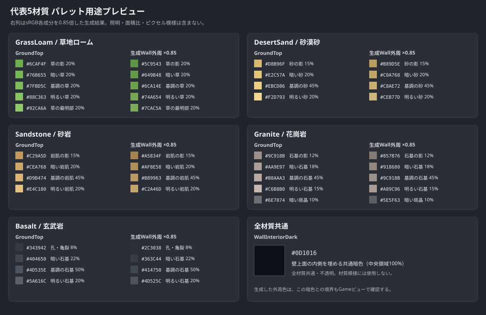

# Farmware 地形タイル表現仕様 — 材質四部構成

- 作成日: 2026-10-24
- 最終更新日: 2026-10-25
- 状態: TERRAIN-01C6-Aで試作・確定する設計仕様
- 対象: GroundBlock、WallBlock、Liquidと、それらを表示するTilemap・Atlas・オートタイル
- 正となる論理データ: [バイオーム・生態コンテンツ仕様](../GameSpecification/BiomeEcologyContentSpecification.md)、[ランダムマップ生成仕様](../GameSpecification/RandomMapGenerationSpecification.md)
- 実装順: [実装ロードマップ](../Development/ImplementationRoadmap.md)
- 材質タイル制作ツール: AsepriteまたはPixelorama

## 1. 目的と適用範囲

本書は、41種類の地形材質を、少数色と単純なブロック状の模様で読み分けられるタイルとして制作するための基準を定める。全体の質感はMinecraftの材質ブロックのような簡潔さを参考にするが、既存作品の配色、模様、画素配置、固有意匠は複製しない。

本書の対象は地形のBase表現である。資源、鉱床、植物、生物、建築物、舗装、耕地、積雪、苔、落葉、灰、塩殻などは、地形とは別の状態またはOverlayとして扱う。TERRAIN-01C6-Aでは代表材質を試作して仕様を確定し、全41材質の量産とRuntime切替は後続項目で行う。

## 2. 2026-10-24以降に変更した基本方針

次を新しい基本方針とする。

- 材質タイルはAsepriteまたはPixeloramaで1 px単位に手描きする。PixelLabは材質タイルの生成、Prompt作成、配色決定には使用しない。
- 各材質は`GroundTop`、`WallTop`、任意の`FaceBoundaryOverlay`、`Face`の4種類を制作単位とする。
- 断面は境界の有無にかかわらず、1段目から通常の`Face`を使う。
- `FaceBoundaryOverlay`を持つ材質では、透明背景のOverlayを断面1段目の`Face`へ重ねる。持たない材質には空の透明Spriteや共通の代替境界を作らない。
- 同じ材質でもGround上面には`GroundTop`、Wall上面には専用の`WallTop`を使う。`WallTop`は材質固有の外周と、全材質共通・不透明の`WallInteriorDark`（初期値`#0D1016`）で構成し、Groundとは明確に読み分けられるようにする。
- `WallTop`外周の手描き元色は、原則として同じ材質の`GroundTop`パレットを使う。Groundとは別Spriteとして外周用の模様を描き、Editor生成時の機械的な暗色化によってWall表示を読み分ける。以前の暗い`WallTop`専用パレットは使用しない。
- Ground崖面とWall前面は、同じ材質の`FaceBoundaryOverlay`入力と`Face`を共有する。境界あり材質ではEditorがGround用の元色合成結果と、Wall用にOverlayだけを暗色化した合成結果を生成する。
- 地形輪郭は初期実装では論理セルに沿う直線とする。不規則な凹凸は後からPresentation表現として追加できるよう、衝突、採掘、配置、保存から分離する。

`WallTop`は、材質別`WallRimEdge`・`WallRimCorner`と全材質共通`WallInteriorDark`に相当する見た目にする。1外周セットにつき、上辺、下辺、左辺、左上角、左下角の5 Spriteを手描きし、Editor生成ツールが左側部品の水平反転から右辺、右上角、右下角を作る。さらに、材質設定に従って外周だけを機械的に暗色化し、`WallInteriorDark`（初期値`#0D1016`、不透明）と合成して接続状態別の完成Sprite 16枚へ焼き込む。Runtimeは周囲4方向の同材質接続状態から完成Spriteを1枚選択するだけとする。

## 3. 材質ごとの四部構成

### 3.1 固定寸法

| 部位 | 寸法 | 用途 | 必須 |
| --- | ---: | --- | --- |
| `GroundTop` | 16×16 px | Ground上面に使う材質表面 | 必須 |
| `WallTop` | 16×16 px | 材質固有の外周と、全材質共通・不透明の`WallInteriorDark`（初期値`#0D1016`）で構成するWall上面 | 必須 |
| `FaceBoundaryOverlay` | 16×16 px | 透明背景へ表層、風化層、草の垂れ、層境界など、断面1段目に追加する画素だけを描く | 材質ごとに任意 |
| `Face` | 16×16 px | 境界の有無にかかわらず断面1段目以降へ使う通常断面 | 必須 |

`FaceBoundaryOverlay`は16×16 pxの透明な制作素材とする。Editor生成ツールが、選択された`Face`差分と元色のOverlayを合成してGround用の断面1段目Spriteを生成する。Wall暗色化が有効な材質では、同じOverlayの不透明画素だけを`WallDarkenFactor`で暗色化し、元の`Face`と合成してWall用の断面1段目Spriteも生成する。`Face`自体を暗色化すると2段目へ移る位置で明るさが戻るため、Wall用でも`Face`は元色のままとする。Runtimeでは`Face`とOverlayを2枚重ねず、用途に対応する生成済み完成Spriteを1枚描画する。Overlayの不透明画素で`Face`を覆えるため、草から土、風化した表面から母岩、凍結表層から凍土のような局所的な切り替えも表現できる。

`FaceBoundaryOverlay`は地形材質だけを対象とする。将来の橋など、断面1段全体の置換や複数段の前面を必要とする建築物は、地形材質へ混在させず、建築物側の専用上面・前面Spriteで表現する。

```text
Ground・境界あり: GroundTop → (Face + 元色OverlayのGround用合成結果)      → Face → Face → …
Ground・境界なし: GroundTop → Face                                         → Face → Face → …
Wall・境界あり:   WallTop   → (Face + 暗色化OverlayのWall用合成結果)      → Face → Face → …
Wall・境界なし:   WallTop   → Face                                         → Face → Face → …
```

Ground崖面とWall前面の表示段数はGameビュー比較後に個別に決める。段数はPresentation専用の表示高であり、論理的な水深、Liquid量、WorldLayer、通行、採掘、セーブ値を変更しない。

### 3.2 GroundとWallの組み立て

- Groundは`GroundTop`、Wallは同じ材質の外周を持つ専用`WallTop`を参照する。
- 同じ材質のGround崖面とWall前面は、同一の`FaceBoundaryOverlay`入力と`Face`を参照する。境界ありではGround用の元色合成結果とWall用の暗色化合成結果を分け、暗色化が無効ならWallもGround用合成結果を再利用する。
- Wall前面の下へ同じ材質の水中Ground崖面が続く場合も、同じ`Face`を使って縦方向へ連続させる。
- Wallと下地Groundの材質が異なる場合は、論理的な材質境界で使用する断面素材を切り替える。
- Wall同士の物理接続判定は、Wall前面を出す位置と`WallTop`の外周表示に使う。同じ材質のWallだけを接続扱いにして共有辺の外周を消す。異なる材質のWallは接続扱いにせず、接する辺で双方がそれぞれの材質外周を表示する。
- 全方向に同材質Wallが隣接しない孤立Wallは、四辺すべての材質外周と中央の`WallInteriorDark`を表示する。全方向を同材質Wallに囲まれた内部Wallは外周を表示せず、セル全体を`WallInteriorDark`で埋める。

### 3.3 材質ごとの可変配列とSprite数

各部位の差分数は事前に固定しない。材質定義のInspectorで必要な数だけ要素を追加できる可変長配列とし、登録した全要素を均等確率で選ぶ。個別のWeightや出現率Overrideは持たせない。不要な差分は配列へ残さず外し、特定の見た目を増やす必要が生じた場合も、同じSpriteを重複登録せず差分構成そのものを見直す。

材質ごとの数量を次の記号で表す。

| 記号 | 内容 | 許容数 |
| --- | --- | ---: |
| `G` | `GroundTop`差分数 | 1以上 |
| `F` | `Face`差分数 | 1以上 |
| `B` | `FaceBoundaryOverlay`差分数 | 0以上。0なら境界なし |
| `W` | `WallTop`外周セット数 | 1以上 |
| `D` | Wall暗色化によるWall用境界Spriteの追加有無 | 有効なら1、無効なら0 |

1つの`WallTop`外周セットは、上辺、下辺、左辺、左上角、左下角から成る5 Spriteを入力とする。Editor生成ツールが左辺を水平反転して右辺を、左上角を水平反転して右上角を、左下角を水平反転して右下角を作る。1枚の画像ファイルを5 SpriteへSliceしてもよい。`WallInteriorDark`と暗色化設定は生成設定なのでSprite数へ含めない。

| 区分 | 材質あたりのSprite数 |
| --- | ---: |
| 手描きする入力Sprite | `G + F + B + 5W` |
| Editorが生成する完成Sprite | `16W + （B > 0ならF×B×(1 + D)、B = 0なら0）` |
| Runtimeで参照する完成Sprite候補 | `G + F + 16W + （B > 0ならF×B×(1 + D)、B = 0なら0）` |

最小構成の`G = 1`、`F = 1`、`B = 0`、`W = 1`では、手描き入力は7 Sprite、Editor生成は16 Sprite、Runtime参照候補は18 Spriteとなる。境界ありの最小構成`G = F = B = W = 1`かつWall暗色化有効`D = 1`では、手描き入力は8 Sprite、Editor生成は18 Sprite、Runtime参照候補は20 Spriteとなる。これは最低数であり、各材質は必要な差分だけ配列へ追加する。

## 4. 手描き制作の基準

### 4.1 制作ツール

- 制作にはAsepriteまたはPixeloramaを使用し、どちらを選んでも完成仕様は同じにする。
- `GroundTop`、`WallTop`の材質別外周5部品、任意の透明な`FaceBoundaryOverlay`、`Face`を実寸16×16 px基準で最初から手描きする。生成画像の切り出しや補正を制作開始点にしない。`WallTop`内部の`WallInteriorDark`（初期値`#0D1016`、不透明）、右辺、右上角、右下角、暗色化後のWall用素材は手描きしない。
- PixelLab用のPrompt、Reference image、Style image、生成設定を材質タイルの制作記録へ含めない。
- 補間、ぼかし、アンチエイリアス、半端なAlphaを使わず、1 px単位で編集する。
- 制作記録には、使用ツール、パレット、差分数、境界の有無、修正履歴を残す。

### 4.2 共通画風

- 16×16 pxを遠目で見ても材質群を識別できる、低詳細でブロック状の模様にする。
- 1材質・1部位は原則3〜5色とする。必要な特徴が読める場合は3色未満でもよい。
- 写真調の細かなノイズ、全画素が激しく明滅する高コントラスト、輪郭線で囲んだ1セル単位のタイル感を避ける。
- 1 pxの点、2〜4 px程度の小塊、短い層、割れ、斑晶を材質に応じて使い分ける。同じ模様規則を全材質へ一律適用しない。
- Base Spriteには弱い上方光を基本として、わずかに画面左上へ寄せた固定明暗を含める。硬い投影影、松明など特定光源の色、時間帯の暗さは焼き込まない。ただし、水平反転する`WallTop`の左辺・左上角・左下角には左右非対称の光、傷、層、文字状模様を入れず、反転後も光源方向が逆転して見えない表現にする。`WallTop`の遠近感は主に上辺と下辺の幅・模様差で示す。
- Normal Mapは初回41材質の必須成果物にしない。Base Sprite完成後、TIME-01Bで代表材質だけを比較する。

### 4.3 差分と接続

`GroundTop`、`Face`、`FaceBoundaryOverlay`、`WallTop`外周セットは、すべて第3.3節の可変長配列で管理する。固定差分数は設けず、各配列内の候補は均等確率で選ぶ。`Face`と`FaceBoundaryOverlay`は独立に選択し、境界あり材質ではGround用の全組合せ`F×B`をEditorで事前生成する。Wall暗色化が有効なら、同じ組合せから暗色化Overlayを使うWall用`F×B`も生成する。`WallTop`は外周セットを均等に選択した後、そのセットに対応する16接続状態から1枚を使う。

- `GroundTop`は外周を共通化せず、隣接した際に単一色の枠、密度の段差、規則的な帯が見えないようにする。
- `WallTop`の外周幅は材質ごとに変更可能な整数制作設定とする。初期値は、斜め見下ろしの遠近感を出すため、奥側である上辺3 px、左右4 px、手前側である下辺5 pxとする。四隅は、その材質に設定された幅で接する二辺を自然につなぐ角表現を持つ。
- 初期値の中央暗色領域は8×8 pxである。中央幅は`16 - 左幅 - 右幅`、中央高さは`16 - 上幅 - 下幅`から自動計算し、外周幅を変えれば中央も変わる。中央サイズだけを独立指定して、外周との間に未定義領域や重複を作らない。
- 上・左右・下の各幅は1 px以上、計算後の中央幅・中央高さも1 px以上でなければならない。同じ材質の全16接続状態と全外観差分は同じ幅設定を共有し、接続状態によって輪郭が跳ねないようにする。
- 同じ材質の`WallTop`外周セットを複数登録する場合も、上・左右・下の幅は材質単位で共有する。外周セットごとに幅を変えて、隣接セル間で輪郭を跳ねさせない。
- `WallTop`内部は全材質共通・不透明の`WallInteriorDark`で埋め、材質ごとの色差や透明度差を付けない。初期値は`DeepBackground`と同じ`#0D1016`とするが、用途と設定値は別に管理する。
- `WallInteriorDark`は`WallTop`生成設定アセットのInspectorに色フィールドとして表示し、全材質分を一括して簡単に変更できるようにする。Alphaは編集対象にせず常に100%とする。色を変更した場合は、生成ツールで全材質の16接続`WallTop` Spriteを再生成する。
- 材質ごとにInspectorへ`DarkenWallSurface`と`WallDarkenFactor`を表示する。`DarkenWallSurface`は既定で有効とし、通常の材質ブロックは機械的に暗色化する。無効時は係数1.0として元色を使う。`WallDarkenFactor`は0より大きく1以下とし、C6-Aの初期比較値を0.85とする。最終値は代表5材質のGameビュー確認で調整する。
- 暗色化はsRGBの8bit RGB各成分へ同じ`WallDarkenFactor`を乗算し、最も近い整数へ丸める。Alphaは変更しない。`WallTop`では材質固有の外周画素だけ、Wall用`FaceBoundaryOverlay`では不透明画素だけを対象にする。`GroundTop`、Ground用`FaceBoundaryOverlay`、`Face`、`WallInteriorDark`は暗色化しない。同じ材質では`WallTop`外周とWall用Overlayへ必ず同じ有効状態と係数を使う。
- 制作時は共通暗色Baseと、各材質の上辺、下辺、左辺、左上角、左下角を用意する。Editor生成ツールが左側3部品を水平反転して右側部品を作り、暗色化後の外周と共通暗色Baseから上下左右4bit接続に対応する16枚の完成`WallTop` Spriteを生成する。Runtimeは材質IDと接続Maskから完成Spriteを1枚選び、辺・角をセルごとに複数描画しない。
- 4bit接続Maskは`上 = 1`、`右 = 2`、`下 = 4`、`左 = 8`とする。bitが立つ方向は同材質Wallへ接続して外周を隠し、`0`は孤立Wall、`15`は全方向接続の内部Wallを表す。二辺がともに露出する交差領域では角部品を使い、一辺だけが露出する場合はその辺部品を端まで使う。
- `FaceBoundaryOverlay`は左右方向に並べた際、表層の厚さや境界線の高さが不自然に途切れないようにする。透明部分では下の`Face`をそのまま見せ、不透明画素だけで必要な範囲を覆う。
- `Face`は、配列内の任意差分同士を上下左右へ隣接させても破綻しないようにする。境界を横断する地層や割れを描く場合は、全差分で接続座標と幅を共通化するか、外周をまたがせない。接続グループは初期仕様へ追加せず、相互接続では表現できない材質が実際に生じた場合だけ後続で検討する。
- どの差分同士でも完全に大模様を接続するのではなく、接続を必要とする模様を限定する。小石や斑晶などの独立模様は外周をまたがせない。
- 差分の均等選択は`UnityEngine.Random`を使わず、WorldLayer、絶対X/Y、断面段、安定材質ID、用途別の表示専用Saltから決定論的に求める。材質定義と生成バージョンが同じなら、同じワールド位置はロード、再描画、実行順にかかわらず毎回同じ差分になる。
- `GroundTop`、`Face`、`FaceBoundaryOverlay`、`WallTop`外周セットには別々のSaltを使う。`WallTop`では接続Maskが変わっても外周セットの選択は変えず、同じセット内の接続Spriteだけを切り替える。
- 配列要素、順序またはRuntime側の表示選択バージョンを変更すれば表示結果が変わり得る。これらはPresentation設定の意図的な変更として扱い、Simulation状態や保存データは変更しない。
- Inspectorと生成ツールは、必須配列が空、Sprite参照が未設定、寸法が16×16 pxでない、いずれかの手描き入力に半透明画素がある、同材質の`WallTop`外周セット間で幅が一致しない、または`WallDarkenFactor`が0以下・1超の場合に生成を拒否して日本語で理由を表示する。生成数が大きい場合は、`16W`、Ground用`F×B`、暗色化有効時のWall用`F×B`の内訳を示して警告する。配列内容や順序、暗色化の有効状態・係数、外周部品、Overlay、`WallInteriorDark`のいずれかを変更した場合は、影響する完成Spriteが古いことを表示して再生成する。

## 5. Liquidと深部

- 淡水と海水は断面を不透明な床Tileで置換せず、通常の`Face`または`FaceBoundaryOverlay`合成済みの1段目用Spriteの上へ、半透明の`Liquid深度Overlay`を重ねる。
- 淡水と海水は浅部で背後の断面を読み取れる透明度を保ち、下へ進むほど液体色と暗さを増して見えなくする。
- マグマは不透明とし、接触する最初の段から背後の`Face`と`FaceBoundaryOverlay`合成結果を見せない。半透明の深度表現をマグマへ流用しない。
- 淡水・海水用およびマグマ用の専用断面Spriteは作らない。マグマの波や発光を表す透明な表面エフェクトを使う場合も、不透明なマグマBaseの上へ重ねる。
- 崖面表示深度より下は、不透明な`DeepBackground` `#0D1016`で塞ぐ。見えない断面を無制限に反復しない。
- 白い14形状の地形境界ハイライトは廃止対象とする。F4のタイル・サブチャンク・チャンク診断表示は別機能なので維持する。

## 6. 部位別パレットの読み方

第7章の`断面境界`と`GroundTop`の色・使用比率・模様方針はC6-Aの確定値である。`WallTop`外周の手描き元は同じ材質の`GroundTop`パレットを使用し、Wall用の表示色はEditor生成時の機械的な暗色化で作る。以前の暗い`WallTop`専用パレットは廃止する。`FaceBoundaryOverlay`と`Face`は、まず`GrassLoam`で低コントラストな暗色化を比較試作し、人間確認後に同じ基準を残り40材質へ適用して再確定する。代表SpriteのGameビュー確認で問題が見つかった場合は、個別Spriteだけを調整せず、第7章の仕様値またはWall暗色化設定を先に更新して同じ材質・部位の全差分へ反映する。

- `日本語名（案）`は制作・レビュー時に材質を読みやすくする表示名候補であり、既存仕様で固定済みの英語`TerrainMaterial ID`を変更しない。正式なゲーム内表示名として採用する場合は、ローカライズ仕様で別途確定する。
- 表の`GroundTop色`、`境界色`、`Face色`は、それぞれGround上面、透明な`FaceBoundaryOverlay`、Ground崖面とWall前面で共用する断面の基準色である。`GroundTop色`は確定値とし、`境界色`と`Face色`は`GrassLoam`試作の確認後に残り40材質を更新して再確定する。
- 本書に記載する地形パレットは、全体として低コントラストを基準にする。同一部位内の隣接色は明度差を小さくし、原則として最暗色と最明色を同じ面積で競合させない。ただし、`GrassLoam`のように十分に明暗差を抑えたパレットへ個別の均等比率を指定した場合は、その個別値を優先する。材質の識別は大きな明暗差だけに頼らず、色相、模様、粒の大きさ、方向性で補う。
- `FaceBoundaryOverlay`と`Face`は、同じ材質の`GroundTop`より全体として暗くする。比較は使用比率を反映した加重平均明度で行い、各パレット内部の明暗差は小さく保つ。上面、境界、断面で同じ色相を使う必要はなく、草から土、風化層から母岩のような材質構造を優先する。最初に`GrassLoam`へ適用し、Gameビューで良好と確認できるまで、残り40材質を機械的に変換しない。
- 亀裂、孔、斑晶などへ相対的に暗い色または明るい色が必要な場合も、使用面積を小さくして面全体が斑に明滅しないようにする。1セル外周を暗色で囲む表現や、常時白く見えるハイライトは使用しない。
- `WallTop`はGroundと別Spriteとして外周用の模様を手描きするが、手描き元の配色・色数・使用比率は原則として同じ材質の`GroundTop`パレットを使う。Editor生成時に外周だけを`WallDarkenFactor`で暗色化し、中央は全材質共通・不透明の`WallInteriorDark`（初期値`#0D1016`）で埋める。生成されたWall表示色を手描き元パレットとして二重に暗くしない。
- `WallTop`外周幅は上3 px・左右4 px・下5 pxを既定値とし、代表材質をGameビューで比較して必要と判断した材質だけOverrideする。41材質の外周元色と外周模様の規則は7.6節を正とする。幅Overrideは16×16 px Spriteの実画面比較後に別途決める。
- `境界色`が`なし`なら、断面1段目へ通常の`Face`をそのまま使う。
- 境界ありの場合も、`FaceBoundaryOverlay`専用の色を必ず増やす必要はない。原則として`GroundTop色`と`Face色`の一部を組み合わせる。ただし、`GrassLoam`の暗色化試作のように、上面と断面の中間明度を低コントラストで保つ必要がある場合は、境界専用の中間色パレットを使ってよい。Wall用の境界色は別途手描きせず、この元色OverlayをEditorで暗色化する。
- 表内のHEXは原則として暗部から明部のおおよその順で記す。地層の上下関係を優先する境界色は、上面側から断面側の順で記す。手描き時に色の調整が必要になった場合は、個々のSpriteへ閉じた変更にせず、本表を更新してから全該当差分へ反映する。
- パレットを追加・更新するときは、HEXだけを列挙せず、各色の横に`影`、`基調`、`明部`、`亀裂`、`斑晶`など、その色を使う対象または役割を記す。同じ色を別の役割へ共用する場合も、それぞれの欄で役割を明示する。
- 各色には使用比率を併記する。`GroundTop`と`Face`はSprite全体の256画素、`FaceBoundaryOverlay`は透明画素を除いた描画画素、`WallTop`外周の手描き元は共通暗色を除いた材質色画素を、それぞれ100%とする。暗色化は使用比率とAlphaを変えない。`WallInteriorDark`は生成された中央領域の100%を占める。
- 記載比率は模様を制作するための目標値であり、各Spriteは通常±5ポイントまで許容する。描画画素が少ない`FaceBoundaryOverlay`だけは±10ポイントまで許容する。可変長配列へ複数差分を登録する場合も、特定差分だけ極端に比率を変えず、登録差分全体の見た目が目標から離れないようにする。
- 4色の標準比率は`影15%・暗部20%・基調45%・明部20%`、5色の標準比率は`影12%・暗部18%・基調45%・明部15%・模様色10%`とする。境界Overlayの標準比率は4色を各25%とする。材質の模様に合わせた個別値が表にある場合は個別値を優先する。
- 積雪、苔、落葉、灰、鉱脈などの可変状態色は表へ含めない。

## 7. 41材質の断面境界・部位別パレット基準表

### 7.1 草地・土壌

| 材質ID | 日本語名（案） | 断面境界 | GroundTop色 | 境界色 | Face色 | 模様方針 |
| --- | --- | --- | --- | --- | --- | --- |
| `GrassLoam` | 草地ローム | あり | 草の影 20% `#6CAF4F`<br>暗い草 20% `#76B655`<br>基調の草 20% `#7FBD5C`<br>明るい草 20% `#88C363`<br>草の最明部 20% `#92CA6A` | 草層の影 20% `#5B9143`<br>草層の暗部 20% `#629747`<br>草層の基調 20% `#699D4B`<br>土層の暗部 20% `#806A50`<br>土層の明部 20% `#8A7457` | 土の影 12% `#67503D`<br>暗い土 18% `#6D5641`<br>基調の土 45% `#735C45`<br>明るい土 15% `#796249`<br>小石 10% `#75685C` | `GroundTop`は現行の明るい低コントラスト草粒を維持する。境界は暗めの緑の草層から暗めの茶色い土層へ切り替え、`Face`は低コントラストな茶色の土層と小石で構成する。根は入れない |
| `MeadowSoil` | 牧草地土壌 | あり | 影 15% `#7EBE5A`<br>暗部 20% `#88C663`<br>基調 45% `#93CE6C`<br>明部 20% `#A0D777` | 上面側暗部 25% `#7EBE5A`<br>上面側明部 25% `#93CE6C`<br>断面側暗部 25% `#7A5639`<br>断面側明部 25% `#B48255` | 影 15% `#5E422F`<br>暗部 20% `#7A5639`<br>基調 45% `#966B45`<br>明部 20% `#B48255` | GrassLoamより明るく均一な草。薄い草層から明るい土へ切り替える |
| `ClaySoil` | 粘土質土壌 | なし | 溝の影 10% `#9B5F43`<br>暗い溝 15% `#AA6A4A`<br>粘土の基調 65% `#B97855`<br>溝のハイライト 10% `#C98663` | なし | 溝の影 10% `#754331`<br>暗い溝 15% `#8A5039`<br>粘土の基調 65% `#A15E42`<br>溝のハイライト 10% `#B96D4C` | 全ての粘土面を同じ基本色で統一し、連結した暗い溝と、その上・左側の控えめな縁ハイライトで丸石状の不規則な網目を描く。上面と断面は同系色 |
| `DryGrassSoil` | 乾燥草地土壌 | あり | 影 15% `#A6A14F`<br>暗部 20% `#B2AB58`<br>基調 45% `#C0B763`<br>明部 20% `#CDC46E` | 上面側暗部 25% `#A6A14F`<br>上面側明部 25% `#C0B763`<br>断面側暗部 25% `#875D39`<br>断面側明部 25% `#A06F43` | 影 15% `#6E4C31`<br>暗部 20% `#875D39`<br>基調 45% `#A06F43`<br>明部 20% `#B98251` | 黄緑の短い草片。境界で乾いた草層を薄く見せる |
| `TropicalRedSoil` | 熱帯赤色土 | なし | 影 15% `#A94D35`<br>暗部 20% `#B85A3D`<br>基調 45% `#C66846`<br>明部 20% `#D47650` | なし | 影 15% `#7B352B`<br>暗部 20% `#93422F`<br>基調 45% `#AD5037`<br>明部 20% `#C25F42` | 赤土の小粒と少数の暗い鉄質斑点 |
| `SandySoil` | 砂質土壌 | なし | 影 15% `#C7A766`<br>暗部 20% `#D2B371`<br>基調 45% `#DDC07D`<br>明部 20% `#E7CC89` | なし | 影 15% `#9B7748`<br>暗部 20% `#B38B55`<br>基調 45% `#C9A164`<br>明部 20% `#D8B775` | 細かな砂粒。長い縞や波紋はSurfaceへ分離する |
| `ForestLoam` | 森林ローム | あり | 影 15% `#5C7D45`<br>暗部 20% `#66874B`<br>基調 45% `#718F52`<br>明部 20% `#7C995A` | 上面側暗部 25% `#5C7D45`<br>上面側明部 25% `#718F52`<br>断面側暗部 25% `#574033`<br>断面側明部 25% `#6B4E3B` | 影 15% `#443329`<br>暗部 20% `#574033`<br>基調 45% `#6B4E3B`<br>明部 20% `#7E5D45` | 暗めの草・有機質表層から湿った褐色土へ移る |
| `HumusSoil` | 腐植土 | あり | 影 15% `#4A362B`<br>暗部 20% `#594031`<br>基調 45% `#684A38`<br>明部 20% `#775541` | 上面側暗部 25% `#594031`<br>上面側明部 25% `#775541`<br>断面側暗部 25% `#30261F`<br>断面側明部 25% `#433128` | 影 15% `#30261F`<br>暗部 20% `#433128`<br>基調 45% `#574033`<br>明部 20% `#6C503D` | 腐植の暗い小塊。境界はわずかに密な有機層 |
| `MountainLoam` | 山地ローム | あり | 影 15% `#71804B`<br>暗部 20% `#7E8D54`<br>基調 45% `#8C9A5E`<br>明部 20% `#9AA768` | 上面側暗部 25% `#71804B`<br>上面側明部 25% `#8C9A5E`<br>断面側暗部 25% `#6D513B`<br>断面側明部 25% `#826148` | 影 15% `#594332`<br>暗部 20% `#6D513B`<br>基調 45% `#826148`<br>明部 20% `#977353` | 疎らな高地草と小石、締まった褐色土 |
| `IslandLoam` | 島嶼ローム | あり | 影 15% `#5EA84F`<br>暗部 20% `#69B459`<br>基調 45% `#75BF63`<br>明部 20% `#82CA6E` | 上面側暗部 25% `#5EA84F`<br>上面側明部 25% `#75BF63`<br>断面側暗部 25% `#7D553D`<br>断面側明部 25% `#946646` | 影 15% `#684533`<br>暗部 20% `#7D553D`<br>基調 45% `#946646`<br>明部 20% `#AA7851` | 明るい草面と暖色寄りの湿った土 |
| `PodzolSoil` | ポドゾル土 | あり | 影 15% `#77836A`<br>暗部 20% `#849078`<br>基調 45% `#929D86`<br>明部 20% `#A0AA94` | 上面側暗部 25% `#77836A`<br>上面側明部 25% `#929D86`<br>溶脱層暗部 25% `#9A876D`<br>溶脱層明部 25% `#C0B99C` | 集積層の暗部 20% `#543C32`<br>集積層の基調 45% `#6E5040`<br>溶脱層の暗部 20% `#9A876D`<br>溶脱層の明部 15% `#C0B99C` | 灰白色の溶脱層を境界で明確にし、その下を暗褐色にする |
| `PeatSoil` | 泥炭土 | あり | 影 15% `#3F3B2C`<br>暗部 20% `#4B4632`<br>基調 45% `#58523A`<br>明部 20% `#655E42` | 上面側暗部 25% `#4B4632`<br>上面側明部 25% `#655E42`<br>断面側暗部 25% `#302821`<br>断面側明部 25% `#40342A` | 影 15% `#302821`<br>暗部 20% `#40342A`<br>基調 45% `#514235`<br>明部 20% `#63513F` | 黒褐色の圧縮された有機片。強い光沢は入れない |
| `SteppeSoil` | ステップ土壌 | あり | 影 15% `#97944A`<br>暗部 20% `#A5A050`<br>基調 45% `#B3AC59`<br>明部 20% `#C1B863` | 上面側暗部 25% `#97944A`<br>上面側明部 25% `#B3AC59`<br>断面側暗部 25% `#895F3F`<br>断面側明部 25% `#A16F48` | 影 15% `#725137`<br>暗部 20% `#895F3F`<br>基調 45% `#A16F48`<br>明部 20% `#B98254` | 短い乾燥草と明るい褐色土 |
| `DryScrubSoil` | 乾燥低木地土壌 | あり | 影 15% `#8E8550`<br>暗部 20% `#9A9058`<br>基調 45% `#A79C61`<br>明部 20% `#B4A86A` | 上面側暗部 25% `#8E8550`<br>上面側明部 25% `#A79C61`<br>断面側暗部 25% `#8B6045`<br>断面側明部 25% `#A06F4F` | 影 15% `#76513B`<br>暗部 20% `#8B6045`<br>基調 45% `#A06F4F`<br>明部 20% `#B57F59` | くすんだ表層と粗めの乾いた土粒 |
| `MarshMud` | 湿地泥 | なし | 影 15% `#4D5140`<br>暗部 20% `#595E48`<br>基調 45% `#666B51`<br>明部 20% `#73785B` | なし | 影 15% `#34362E`<br>暗部 20% `#44473A`<br>基調 45% `#555947`<br>明部 20% `#676B55` | 暗い泥の不規則な小塊。水面反射はLiquidへ分離する |
| `AlluvialSoil` | 沖積土 | あり | 影 15% `#80654D`<br>暗部 20% `#90735A`<br>基調 45% `#A18167`<br>明部 20% `#B18F74` | 上面側暗部 25% `#A18167`<br>上面側明部 25% `#B18F74`<br>断面側暗部 25% `#725744`<br>断面側明部 25% `#896954` | 影 15% `#5D4638`<br>暗部 20% `#725744`<br>基調 45% `#896954`<br>明部 20% `#A17C63` | 境界に薄いシルト層、断面に短い水平堆積 |
| `PermafrostSoil` | 永久凍土 | あり | 影 15% `#859699`<br>暗部 20% `#93A3A5`<br>基調 45% `#A2B0B1`<br>明部 20% `#B1BDBD` | 上面側暗部 25% `#A2B0B1`<br>上面側明部 25% `#B1BDBD`<br>断面側暗部 25% `#6E7979`<br>断面側明部 25% `#81908F` | 影 15% `#5C6565`<br>暗部 20% `#6E7979`<br>基調 45% `#81908F`<br>明部 20% `#96A4A2` | 境界に凍結した明色層。断面は青灰色の凍土 |
| `TundraSoil` | ツンドラ土壌 | あり | 影 15% `#77846B`<br>暗部 20% `#849178`<br>基調 45% `#929E85`<br>明部 20% `#A0AA92` | 上面側暗部 25% `#77846B`<br>上面側明部 25% `#929E85`<br>断面側暗部 25% `#706251`<br>断面側明部 25% `#83725E` | 影 15% `#5E5344`<br>暗部 20% `#706251`<br>基調 45% `#83725E`<br>明部 20% `#96836C` | 低い植生色から冷たい褐色土へ移る |
| `VolcanicAshSoil` | 火山灰土 | なし | 影 15% `#55555A`<br>暗部 20% `#626268`<br>基調 45% `#707077`<br>明部 20% `#7E7E86` | なし | 影 15% `#3C3C42`<br>暗部 20% `#494950`<br>基調 45% `#57575F`<br>明部 20% `#66666E` | 灰色の細粒と少数の暗い粒。発光は入れない |

### 7.2 礫・砂・火山性表層

| 材質ID | 日本語名（案） | 断面境界 | GroundTop色 | 境界色 | Face色 | 模様方針 |
| --- | --- | --- | --- | --- | --- | --- |
| `AlpineScree` | 高山岩屑 | なし | 影 15% `#77756D`<br>暗部 20% `#85827A`<br>基調 45% `#939087`<br>明部 20% `#A29F95` | なし | 影 15% `#55534E`<br>暗部 20% `#66645E`<br>基調 45% `#77756E`<br>明部 20% `#89877E` | 2〜4 pxの角張った礫を少数配置する |
| `Gravel` | 礫 | なし | 影 15% `#6F7070`<br>暗部 20% `#7E7F7F`<br>基調 45% `#8D8E8D`<br>明部 20% `#9C9D9B` | なし | 影 15% `#555758`<br>暗部 20% `#666869`<br>基調 45% `#77797A`<br>明部 20% `#898B8C` | 小さな丸みのある粒を均等に散らす |
| `DesertGravel` | 砂漠礫 | なし | 影 15% `#9C815D`<br>暗部 20% `#AD9068`<br>基調 45% `#BEA075`<br>明部 20% `#CFB083` | なし | 影 15% `#755D44`<br>暗部 20% `#896C4D`<br>基調 45% `#9E7C57`<br>明部 20% `#B38C64` | 暖色の礫と砂の混在。礫は密集させすぎない |
| `DesertSand` | 砂漠砂 | なし | 砂の影 15% `#D8B96F`<br>暗い砂 20% `#E2C57A`<br>基調の砂 45% `#EBCD86`<br>明るい砂 20% `#F2D793` | なし | 砂の影 15% `#B08C50`<br>暗い砂 20% `#C39F5C`<br>基調の砂 45% `#D4B168`<br>明るい砂 20% `#E2C37A` | 明るい細粒を低コントラストで配置する |
| `Scoria` | スコリア | なし | 影 15% `#663C37`<br>暗部 20% `#75443D`<br>基調 45% `#854D43`<br>明部 20% `#95574B` | なし | 影 15% `#462C2B`<br>暗部 20% `#573331`<br>基調 45% `#693B36`<br>明部 20% `#7B453D` | 暗い気孔を点在させた赤褐色の火山礫 |

### 7.3 堆積岩

| 材質ID | 日本語名（案） | 断面境界 | GroundTop色 | 境界色 | Face色 | 模様方針 |
| --- | --- | --- | --- | --- | --- | --- |
| `CompactedSediment` | 圧密堆積物 | なし | 影 15% `#8B725B`<br>暗部 20% `#997F65`<br>基調 45% `#A88D70`<br>明部 20% `#B79B7C` | なし | 影 15% `#67513F`<br>暗部 20% `#79604A`<br>基調 45% `#8B7056`<br>明部 20% `#9E8063` | 短い水平層を疎らに入れる |
| `Sandstone` | 砂岩 | あり | 岩肌の影 15% `#C29A5D`<br>暗い岩肌 20% `#CEA768`<br>基調の岩肌 45% `#D9B474`<br>明るい岩肌 20% `#E4C180` | 上面側暗部 25% `#D9B474`<br>上面側明部 25% `#E4C180`<br>断面側明部 25% `#AD824B`<br>断面側暗部 25% `#946C3F` | 岩肌の影 15% `#946C3F`<br>暗い岩肌 20% `#AD824B`<br>基調の岩肌 45% `#C49759`<br>明るい岩肌 20% `#D8AC6B` | 境界に明るい風化層、断面に太さを変えた水平層 |
| `Conglomerate` | 礫岩 | なし | 影 12% `#88725B`<br>暗部 18% `#9B846A`<br>基調 45% `#AF9679`<br>明部 15% `#C2A889`<br>模様色 10% `#6F6B63` | なし | 影 12% `#665344`<br>暗部 18% `#796553`<br>基調 45% `#8E7862`<br>明部 15% `#A28B71`<br>模様色 10% `#595957` | 母材の中に2〜3 pxの丸い礫を埋める |
| `Limestone` | 石灰岩 | あり | 影 15% `#B9B59F`<br>暗部 20% `#C6C2AD`<br>基調 45% `#D3CFBC`<br>明部 20% `#DFDCCA` | 上面側暗部 25% `#D3CFBC`<br>上面側明部 25% `#DFDCCA`<br>断面側明部 25% `#AFAA96`<br>断面側暗部 25% `#9B9784` | 影 15% `#888574`<br>暗部 20% `#9B9784`<br>基調 45% `#AFAA96`<br>明部 20% `#C3BEAA` | 境界は明るい風化面、断面は短い層と小孔 |
| `Dolomite` | 苦灰岩 | なし | 影 15% `#AAA99F`<br>暗部 20% `#B8B7AD`<br>基調 45% `#C6C5BB`<br>明部 20% `#D4D3C9` | なし | 影 15% `#7C7D76`<br>暗部 20% `#8F9087`<br>基調 45% `#A3A399`<br>明部 20% `#B7B6AB` | 角張った結晶粒を低コントラストで散らす |
| `Mudstone` | 泥岩 | あり | 影 15% `#75675F`<br>暗部 20% `#83736A`<br>基調 45% `#918078`<br>明部 20% `#9F8E85` | 上面側暗部 25% `#918078`<br>上面側明部 25% `#9F8E85`<br>断面側暗部 25% `#62554F`<br>断面側明部 25% `#74635B` | 影 15% `#514743`<br>暗部 20% `#62554F`<br>基調 45% `#74635B`<br>明部 20% `#877168` | 境界に薄い層、断面に途切れた細い水平層 |

### 7.4 変成岩・深成岩

| 材質ID | 日本語名（案） | 断面境界 | GroundTop色 | 境界色 | Face色 | 模様方針 |
| --- | --- | --- | --- | --- | --- | --- |
| `Slate` | 粘板岩 | なし | 影 15% `#4C5660`<br>暗部 20% `#596570`<br>基調 45% `#677480`<br>明部 20% `#75838F` | なし | 影 15% `#353E47`<br>暗部 20% `#424C56`<br>基調 45% `#505B66`<br>明部 20% `#5F6B77` | 平行な短い劈開線を少数入れる |
| `Granite` | 花崗岩 | なし | 石基の影 12% `#9C918B`<br>暗い石基 18% `#AA9E97`<br>基調の石基 45% `#B8AAA3`<br>明るい石基 15% `#C6B8B0`<br>暗い斑晶 10% `#6E7074` | なし | 石基の影 12% `#756B67`<br>暗い石基 18% `#887C76`<br>基調の石基 45% `#9B8E87`<br>明るい石基 15% `#AEA099`<br>暗い斑晶 10% `#575B60` | 明暗と灰色の粗い斑晶を2〜3 pxで散らす |
| `Granodiorite` | 花崗閃緑岩 | なし | 影 12% `#969A94`<br>暗部 18% `#A5A9A2`<br>基調 45% `#B4B8AF`<br>明部 15% `#C3C7BC`<br>模様色 10% `#747A78` | なし | 影 12% `#6F746F`<br>暗部 18% `#808680`<br>基調 45% `#929890`<br>明部 15% `#A5ABA1`<br>模様色 10% `#565C5B` | Graniteより灰色寄りで、明暗斑晶の比率を均す |
| `Schist` | 片岩 | なし | 影 15% `#596169`<br>暗部 20% `#666F77`<br>基調 45% `#747D85`<br>明部 20% `#828B93` | なし | 影 15% `#3E464E`<br>暗部 20% `#4B555E`<br>基調 45% `#59636D`<br>明部 20% `#68727C` | やや波打つ短い片理を同方向へ揃えすぎず配置する |
| `Gneiss` | 片麻岩 | なし | 影 12% `#77716D`<br>暗部 18% `#85807A`<br>基調 45% `#948F87`<br>明部 15% `#A39E95`<br>模様色 10% `#555B62` | なし | 影 12% `#57514E`<br>暗部 18% `#69625D`<br>基調 45% `#7B746D`<br>明部 15% `#8E877E`<br>模様色 10% `#41464C` | 明暗2系統の太い帯を短く分断して入れる |
| `Quartzite` | 珪岩 | なし | 影 12% `#B7B3AC`<br>暗部 18% `#C4C0B9`<br>基調 45% `#D1CDC6`<br>明部 15% `#DEDAD3`<br>模様色 10% `#8D9197` | なし | 影 12% `#89867F`<br>暗部 18% `#9C9991`<br>基調 45% `#AFACA4`<br>明部 15% `#C2BFB6`<br>模様色 10% `#6B7078` | 明るい緻密面に少数の灰色粒と短い割れ |

### 7.5 火山岩・超苦鉄質岩

| 材質ID | 日本語名（案） | 断面境界 | GroundTop色 | 境界色 | Face色 | 模様方針 |
| --- | --- | --- | --- | --- | --- | --- |
| `Basalt` | 玄武岩 | なし | 孔・亀裂 8% `#343942`<br>暗い石基 22% `#404650`<br>基調の石基 50% `#4D535E`<br>明るい石基 20% `#5A616C` | なし | 孔・亀裂 8% `#252A31`<br>暗い石基 22% `#303640`<br>基調の石基 50% `#3C434D`<br>明るい石基 20% `#494F5A` | 暗い緻密面に短い亀裂と少数の小孔 |
| `Andesite` | 安山岩 | なし | 影 15% `#666B70`<br>暗部 20% `#74797E`<br>基調 45% `#82878C`<br>明部 20% `#90959A` | なし | 影 15% `#484D52`<br>暗部 20% `#565B60`<br>基調 45% `#64696E`<br>明部 20% `#73787D` | 中間灰色の細粒と少数の明色斑晶 |
| `Tuff` | 凝灰岩 | なし | 影 15% `#918573`<br>暗部 20% `#A09480`<br>基調 45% `#AFA38E`<br>明部 20% `#BEB29C` | なし | 影 15% `#6B6154`<br>暗部 20% `#7D7161`<br>基調 45% `#908271`<br>明部 20% `#A39580` | 火山灰母材に角張った小片を疎らに埋める |
| `Serpentinite` | 蛇紋岩 | なし | 影 15% `#3F6655`<br>暗部 20% `#4B745F`<br>基調 45% `#58826A`<br>明部 20% `#668F76` | なし | 影 15% `#2C493D`<br>暗部 20% `#375746`<br>基調 45% `#426653`<br>明部 20% `#4E755F` | 緑色の不規則な短い脈を少数入れる |
| `Peridotite` | かんらん岩 | なし | 影 15% `#687343`<br>暗部 20% `#76804B`<br>基調 45% `#858E54`<br>明部 20% `#949C5E` | なし | 影 15% `#4A532F`<br>暗部 20% `#586238`<br>基調 45% `#677141`<br>明部 20% `#76804A` | 黄緑〜オリーブの粗い鉱物粒を配置する |

C6-Aの確定値は、断面境界あり17材質、なし24材質である。境界の有無は地質学的な厳密分類ではなく、16×16 pxのゲーム画面で上面から断面への変化を見せる価値があるか、追加Spriteの制作費に見合うかで判断した。境界あり材質は同じ`FaceBoundaryOverlay`入力をGround崖面とWall前面で共有するが、Editor合成結果はGround用の元色版とWall用の暗色化版に分ける。用途別の手描きOverlayは設けない。今後この列を変更する場合は、単なるアート調整ではなくC6-A仕様変更として扱う。

### 7.6 `WallTop`外周の手描き元パレットと暗色化

41材質の`WallTop`外周は専用の暗色パレットを持たない。手描き元の色、役割、使用比率は、第7.1〜7.5節にある同じ材質の`GroundTop色`をそのまま使用する。これにより、同一材質としての色相と特徴を保ったまま、Editor生成時の一貫した暗色化でGroundとWallを読み分ける。以前記載していた41材質の暗い`WallTop`専用パレットは廃止し、手描き元または生成後の入力へ使用しない。

`WallTop`は`GroundTop`と同じ完成Spriteを流用するのではない。上辺、下辺、左辺、左上角、左下角の5部品を外周専用の画素配置で手描きし、同じ材質の`GroundTop`が持つ粒、溝、亀裂、斑晶などの模様方針を外周幅の範囲で簡略化して引き継ぐ。右辺、右上角、右下角はEditorが左側部品を水平反転して生成する。

通常の材質ブロックは`DarkenWallSurface = true`を基本とし、`WallTop`外周とWall用`FaceBoundaryOverlay`へ同じ`WallDarkenFactor`を適用する。C6-Aの初期比較値は0.85とする。暗色化後のHEXは仕様表へ手入力せず、第4.3節の決定論的な変換結果を正とする。発光など、暗色化が材質の意味を損なう例外だけを`DarkenWallSurface = false`とし、その理由を材質設定へ記録する。

初期比較値0.85を使った`GrassLoam`の例を次に示す。右列はEditorの生成結果であり、手描きパレットではない。

| 役割・比率 | 手描き元色 | 生成Wall表示色（×0.85） |
| --- | --- | --- |
| 草の影 20% | `#6CAF4F` | `#5C9543` |
| 暗い草 20% | `#76B655` | `#649B48` |
| 基調の草 20% | `#7FBD5C` | `#6CA14E` |
| 明るい草 20% | `#88C363` | `#74A654` |
| 草の最明部 20% | `#92CA6A` | `#7CAC5A` |

全材質で外周幅Overrideはまだ設定せず、上3 px・左右4 px・下5 pxを使用する。幅の例外は16×16 px SpriteをGameビューで比較し、外周が細すぎる、または材質模様を判別できない場合だけ別途決定する。同じ材質の全接続状態と全外観差分は、確定した材質単位の幅、暗色化の有効状態、`WallDarkenFactor`を共有する。

## 8. 模様の方向性見本


上の画像は、草土、乾燥草地、表層のある土、砂岩、花崗岩、玄武岩を想定し、各行を旧`Top`、旧`FaceBoundary`、`Face`の順に並べた概念見本である。上段は`GroundTop`の参考に限定し、`WallTop`の見本ではない。中央段は完成した`FaceBoundaryOverlay`素材ではなく、境界表現の参考に限定する。草土の配色とコントラストは概念参考に限定し、現在の`GrassLoam`は第7章の暗めで低コントラストな茶色の断面パレットを正とする。完成Sprite、確定パレット、41材質の網羅表ではなく、輪郭、模様密度、接続位置は16×16 pxの手描き試作で調整する。

## 9. 描画レイヤー

奥から手前への基本順序は次とする。実際のTilemap数はC6-Aでバッチ数と更新範囲を比較して決める。

| 順序 | 表示内容 |
| ---: | --- |
| 1 | `DeepBackground` |
| 2 | Groundの`Face`（1段目は必要に応じて`FaceBoundaryOverlay`合成済み） |
| 3 | Groundの`GroundTop` |
| 4 | 淡水・海水の`Liquid深度Overlay`、または不透明なマグマBase |
| 5 | Liquid波紋・反射・流れ |
| 6 | Wallの`Face`（1段目は必要に応じて`FaceBoundaryOverlay`合成済み） |
| 7 | Wallの共通暗色内部と材質別外周から成る`WallTop` |
| 8 | Surface、資源、配置物 |

表示側は有効地形を参照し、変更セルを含むDirtyサブチャンクと必要な外周Haloだけを再構築する。Tilemap全走査や全チャンク再描画を行わない。

## 10. Unity取込の暫定基準

- Texture Type: `Sprite (2D and UI)`
- Sprite Mode: シートは`Multiple`、単体は`Single`
- Pixels Per Unit: `16`
- Filter Mode: `Point`
- Compression: `None`
- Generate Mip Maps: `Off`
- Mesh Type: 原則`Full Rect`
- sRGB (Color Texture): `On`
- Read/Write: 手描き入力はEditor生成時の画素読取に必要なため`On`。生成済み完成Spriteは`Off`
- Alpha: すべての手描き入力で0または255だけを使用し、半透明画素を含めない
- Pivot: `GroundTop`と`WallTop`は中央、`FaceBoundaryOverlay`と`Face`はEditor合成時に画素位置が一致するよう同じ上端基準へ統一する。正確な値は試作後に固定する
- AtlasのPaddingとTight Packingは、隣接色のにじみがない設定を実機表示で確認する

Editor生成ツールは完成PNGを`Point`、16 PPU、非圧縮、Mip Mapなし、sRGB、`Full Rect`、中央Pivotの単一SpriteとしてImportする。入力または設定の画像Fingerprintを材質ごとに記録し、画像内容、配列順、外周幅、暗色化、共通内部色、出力先のいずれかが変わった場合は要再生成と表示する。再生成時は同じパスを上書きして`.meta`とGUIDを維持し、前回その材質が生成した記録済みPNGのうち今回不要になったものだけを削除する。手描き入力、記録外Asset、フォルダーは削除しない。

## 11. C6-Aで先に作る代表材質

最初から41材質を量産せず、次の5材質で四部構成を検証する。

| 材質 | 主な検証 |
| --- | --- |
| `GrassLoam` | 草だけの`GroundTop`、同じ元パレットから専用部品を描いてEditorで暗色化する`WallTop`、暗めの緑の草層から暗めの茶色い土層へ切り替える透明な`FaceBoundaryOverlay`、低コントラストな茶色の土層と小石の`Face`。根は使わない |
| `DesertSand` | 境界なし、明るい細粒、低コントラスト |
| `Sandstone` | 風化境界と方向性のある地層、左右・上下の接続 |
| `Granite` | 境界なし、粗い斑晶、5色材質の可読性 |
| `Basalt` | 境界なし、暗色同士の判別と深部背景との差 |

### 11.1 代表5材質の`WallTop`暗色化プレビュー

`WallTop`外周の手描き元パレットと暗色化規則は7.6節を正とする。次のプレビューは、`GrassLoam`、`DesertSand`、`Sandstone`、`Granite`、`Basalt`について、同じ材質の通常色を初期比較値0.85で暗色化した結果と、共通`WallInteriorDark`との組合せを比較するための補助資料である。



プレビューは手描き元HEXとEditor暗色化後のHEXを矩形表示し、各色の横へ用途と使用比率を記載したものである。生成後のHEXは手描き入力ではない。照明、実際の面積比、ピクセル模様は含まない。係数と幅Overrideの判断は16×16 px SpriteをGameビューへ配置し、通常照明と`WallInteriorDark`の組合せで行う。

代表5材質をGameビューへ仮接続し、確定済みの境界有無、同材質の通常色を使う外周元Sprite、Wall暗色化を前提に、GroundとWallの読み分け、反復感、液体越しの断面、背景上の可読性を確認する。実画面で問題が見つかった場合は、個別Spriteだけでなく7.6節の規則または`WallDarkenFactor`を更新する。

## 12. 残る要確認事項

41材質の境界有無、`GroundTop`パレット、`WallTop`外周の手描き元色と生成方式、Ground崖面・Wall前面で同じ`FaceBoundaryOverlay`入力を共有する方式は確定済みである。`FaceBoundaryOverlay`と`Face`は`GrassLoam`で上面より暗く、部位内コントラストを抑えた配色を比較試作中であり、残る判断と実画面確認は次のとおり。

1. **`FaceBoundaryOverlay`と`Face`の暗色化基準**
   `GrassLoam`の`GroundTop`は変更せず、境界は暗めの緑の草層から暗めの茶色い土層へ切り替え、`Face`は暗めで低コントラストな茶色5色へ変更した。Gameビューでコントラスト、Groundとの識別、縦反復、水越しの見え方を確認し、良好なら同じ明度関係を残り40材質へ適用する。色相や模様は各材質固有の構造を維持し、上面色への統一や単純な一括減算では変換しない。

2. **Wall暗色化係数と`WallTop`外周幅の材質別Override**
   `WallInteriorDark`は不透明、初期値は`DeepBackground`と同じ`#0D1016`とする。全材質共通値としてInspectorから変更でき、変更後は完成Spriteを再生成する。通常材質は暗色化有効、初期比較係数0.85とする。残る判断は、代表5材質の実画面比較で共通係数を調整するか、暗色化を無効にする例外があるか、上3 px・左右4 px・下5 pxから変更する材質があるかである。必要な例外だけを理由とともに記録する。

3. **Wall上面の接続表現**
   同じ材質のWallだけを接続扱いにして共有辺を消し、異材質Wallは接続せず双方の外周を出す。制作時は共通暗色Baseと材質別の5部品を管理し、Editorツールが左側部品を水平反転して右側を補い、上下左右4bitの16接続Spriteへ焼き込む。残る確認は、反転箇所で光や模様の方向が逆転して見えないこと、可変外周幅を使った全16状態、異材質境界、チャンク境界で継ぎ目が破綻しないことである。

4. **細道と凹凸輪郭**
   細道の要否は以前の合意どおり後で確認する。不規則な凹凸輪郭も初期実装には含めない。

## 13. C6-Aの完了条件

- 四部構成、1段目からの`Face`使用、任意の`FaceBoundaryOverlay`とのEditor合成を、代表5材質の16×16 px手描きSpriteで確認した。
- `GroundTop`と、通常色の手描き元外周を機械的に暗色化して共通暗色内部と合成した`WallTop`を使ったGameビューで、GroundとWallを識別できることを人間が確認した。
- `WallInteriorDark`の初期値`#0D1016`、不透明固定、`DarkenWallSurface`、`WallDarkenFactor`、Inspector変更と再生成の導線を確認した。材質別の外周幅、均等選択する可変長配列、5入力部品からの水平反転、生成ツールの`16W`・Ground用`F×B`・暗色化有効時のWall用`F×B`出力、Ground崖面段数、Wall前面段数を確認した。
- 淡水・海水の`Liquid深度Overlay`で、専用水中断面なしに断面が浅部から深部へ消えることを確認した。
- マグマが接触する最初の段から不透明になり、背後の断面が透けないことを確認した。
- 41材質表の確定済み境界有無と、Ground崖面・Wall前面でOverlay入力を共有し、Ground用元色合成結果とWall用暗色化合成結果を使い分ける契約どおりに、境界あり17材質・なし24材質を扱えることを確認した。
- 41材質表の確定`GroundTop`・`FaceBoundaryOverlay`・`Face`パレット、7.6節の`WallTop`手描き元パレットと暗色化規則、各部位の使用比率、模様方針どおりに代表Spriteを制作し、人間がGameビューで確認した。`GrassLoam`で採用した境界・断面の暗色化基準を残り40材質へ適用し、仕様値を変更した場合は表と全該当Spriteを同時に更新した。
- Atlas、Pivot、描画Bounds、カリング余白、Dirty更新、Floating Origin、Pixel Perfect表示の実装条件を記録した。
- 白い旧境界ハイライトを新表示で不要と判断できた。削除自体はC6-Dの表示置換と同じ変更単位で行う。
